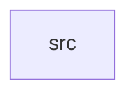

_Generated by CodeAtlas._

## Details

Owns 0 symbols across 1 file(s).

### src

Owns 117 symbols across 14 file(s).

**Related Classes/Methods:** _None_

**Source Files:**

- `core/src/audit.rs`
  - `core.src.audit.AuditEvent`
  - `core.src.audit.AuditEvent.context_retrieved`
  - `core.src.audit.AuditEvent.document_indexed`
  - `core.src.audit.AuditEvent.document_opened`
  - `core.src.audit.AuditEvent.new`
  - `core.src.audit.AuditEvent.search_performed`
  - `core.src.audit.AuditEventKind`
  - `core.src.audit.AuditLog`
  - `core.src.audit.AuditLog.events`
  - `core.src.audit.AuditLog.new`
  - `core.src.audit.AuditLog.record`
  - `core.src.audit.tests.test_audit_event_context_retrieved`
  - `core.src.audit.tests.test_audit_event_creation`
  - `core.src.audit.tests.test_audit_event_document_opened`
  - `core.src.audit.tests.test_audit_event_search_performed`
  - `core.src.audit.tests.test_audit_event_serialization`
  - `core.src.audit.tests.test_audit_log_event`
- `core/src/context.rs`
  - `core.src.context.AgentContext`
  - `core.src.context.ContextSection`
  - `core.src.context.assemble`
  - `core.src.context.build_heading_path`
  - `core.src.context.find_section_for_page`
- `core/src/document.rs`
  - `core.src.document.DocumentMetadata`
  - `core.src.document.PdfDocument`
  - `core.src.document.PdfDocument.all_pages`
  - `core.src.document.PdfDocument.fingerprint`
  - `core.src.document.PdfDocument.form_fields`
  - `core.src.document.PdfDocument.has_forms`
  - `core.src.document.PdfDocument.is_encrypted`
  - `core.src.document.PdfDocument.metadata`
  - `core.src.document.PdfDocument.open`
  - `core.src.document.PdfDocument.open_with_password`
  - `core.src.document.PdfDocument.page`
  - `core.src.document.PdfDocument.page_count`
  - `core.src.document.PdfDocument.path`
  - `core.src.document.PdfDocument.permissions`
  - `core.src.document.PdfDocument.structure`
  - `core.src.document.tests.test_pdf_document_creation`
- `core/src/error.rs`
  - `core.src.error.Error`
- `core/src/forms.rs`
  - `core.src.forms.FormFieldType`
  - `core.src.forms.FormFieldType.as_str`
  - `core.src.forms.PdfFormField`
  - `core.src.forms.PdfFormField.new`
  - `core.src.forms.PdfFormField.with_value`
  - `core.src.forms.extract_form_fields`
  - `core.src.forms.has_forms`
  - `core.src.forms.tests.test_form_field_creation`
  - `core.src.forms.tests.test_form_field_serialization`
  - `core.src.forms.tests.test_form_field_type_as_str`
  - `core.src.forms.tests.test_form_field_type_serialization`
  - `core.src.forms.tests.test_form_field_with_value`
  - `core.src.forms.tests.test_multiple_field_types`
- `core/src/heading_extractor.rs`
  - `core.src.heading_extractor.HeadingSection`
  - `core.src.heading_extractor.HierarchicalHeadings`
  - `core.src.heading_extractor.HierarchicalHeadings.default`
  - `core.src.heading_extractor.HierarchicalHeadings.new`
  - `core.src.heading_extractor.detect_heading_level`
  - `core.src.heading_extractor.extract_hierarchy`
- `core/src/index.rs`
  - `core.src.index.PageResult`
  - `core.src.index.PdfIndex`
  - `core.src.index.PdfIndex.build`
  - `core.src.index.PdfIndex.create_schema`
  - `core.src.index.PdfIndex.load`
  - `core.src.index.PdfIndex.page_range`
  - `core.src.index.PdfIndex.pages_with_heading`
  - `core.src.index.PdfIndex.sanitize_fts5_query`
  - `core.src.index.PdfIndex.search`
- `core/src/markdown.rs`
  - `core.src.markdown.MarkdownOutput`
  - `core.src.markdown.estimate_tokens`
  - `core.src.markdown.format_text_as_markdown`
  - `core.src.markdown.heading_to_markdown`
  - `core.src.markdown.page_to_markdown`
  - `core.src.markdown.section_to_markdown`
- `core/src/navigator.rs`
  - `core.src.navigator.PdfNavigator`
  - `core.src.navigator.PdfNavigator.chapters`
  - `core.src.navigator.PdfNavigator.new`
  - `core.src.navigator.PdfNavigator.page_to_markdown`
  - `core.src.navigator.PdfNavigator.pages_for`
  - `core.src.navigator.PdfNavigator.retrieve`
  - `core.src.navigator.PdfNavigator.section_to_markdown`
  - `core.src.navigator.PdfNavigator.sections_in`
  - `core.src.navigator.PdfNavigator.with_shared_index`
  - `core.src.navigator.PdfNavigatorData`
- `core/src/page.rs`
  - `core.src.page.BoundingBox`
  - `core.src.page.ContentRegion`
  - `core.src.page.PageMetadata`
  - `core.src.page.RegionType`
- `core/src/pdf_parser.rs`
  - `core.src.pdf_parser.ParsedDocument`
  - `core.src.pdf_parser.init_pdfium`
  - `core.src.pdf_parser.map_pdfium_open_error`
  - `core.src.pdf_parser.parse_document_open`
  - `core.src.pdf_parser.parse_document_open_with_password`
  - `core.src.pdf_parser.tests.test_parse_garbage_file_returns_error_not_fake_content`
  - `core.src.pdf_parser.tests.test_parse_nonexistent_file_returns_error`
  - `core.src.pdf_parser.try_parse_with_pdfium`
- `core/src/security.rs`
  - `core.src.security.EncryptionStatus`
  - `core.src.security.PdfPermissions`
  - `core.src.security.PdfPermissions.all_allowed`
  - `core.src.security.PdfPermissions.any_restricted`
  - `core.src.security.PdfPermissions.default`
  - `core.src.security.check_encryption`
  - `core.src.security.describe_security_handler`
  - `core.src.security.extract_permissions`
  - `core.src.security.open_with_password`
  - `core.src.security.tests.test_check_encryption_nonexistent_file_is_error`
  - `core.src.security.tests.test_encryption_status_encrypted`
  - `core.src.security.tests.test_encryption_status_not_encrypted`
  - `core.src.security.tests.test_extract_permissions_nonexistent_file_is_error`
  - `core.src.security.tests.test_pdf_permissions_all_allowed`
  - `core.src.security.tests.test_pdf_permissions_any_restricted`
  - `core.src.security.tests.test_pdf_permissions_default`
  - `core.src.security.tests.test_pdf_permissions_serialization`
- `core/src/structure.rs`
  - `core.src.structure.DocumentStructure`
  - `core.src.structure.DocumentStructure.default`
  - `core.src.structure.DocumentStructure.new`
  - `core.src.structure.HeadingNode`
  - `core.src.structure.TocEntry`
