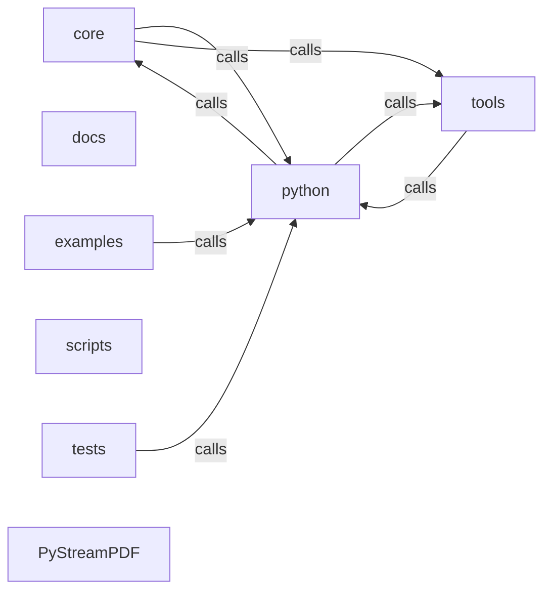

_Generated by CodeAtlas._

## Details

Architecture map of PyStreamPDF.

### core

Owns 0 symbols across 1 file(s).

**Related Classes/Methods:** _None_

### docs

Owns 0 symbols across 3 file(s).

**Related Classes/Methods:** _None_

### examples

Owns 7 symbols across 3 file(s).

**Related Classes/Methods:** _None_

**Source Files:**

- `examples/mcp_pystreampdf.py`
  - `examples.mcp_pystreampdf.main`
- `examples/token_budget_and_cache_example.py`
  - `examples.token_budget_and_cache_example.example_basic_budget_config`
  - `examples.token_budget_and_cache_example.example_integration_with_chunker`
  - `examples.token_budget_and_cache_example.example_pdf_caching`
  - `examples.token_budget_and_cache_example.example_pdf_caching.simulate_pdf_processing`
  - `examples.token_budget_and_cache_example.example_yaml_config`
  - `examples.token_budget_and_cache_example.main`

### python

Owns 0 symbols across 1 file(s).

**Related Classes/Methods:** _None_

### scripts

Owns 0 symbols across 3 file(s).

**Related Classes/Methods:** _None_

### tests

Owns 774 symbols across 34 file(s).

**Related Classes/Methods:** _None_

**Source Files:**

- `tests/conftest.py`
  - `tests.conftest.deeply_nested_pdf`
  - `tests.conftest.encrypted_pdf`
  - `tests.conftest.large_pdf`
  - `tests.conftest.malformed_pdf`
  - `tests.conftest.multi_page_pdf`
  - `tests.conftest.permission_restricted_pdf`
  - `tests.conftest.simple_pdf`
  - `tests.conftest.temp_pdf_dir`
  - `tests.conftest.truncated_pdf`
- `tests/test_audit.py`
  - `tests.test_audit.test_audit_log_creation`
  - `tests.test_audit.test_events_readable`
  - `tests.test_audit.test_in_memory_audit`
  - `tests.test_audit.test_record_open`
  - `tests.test_audit.test_record_search`
- `tests/test_benchmark.py`
  - `tests.test_benchmark.test_parse_large_pdf_performance`
  - `tests.test_benchmark.test_structure_extraction`
- `tests/test_cache.py`
  - `tests.test_cache.TestPDFCache`
  - `tests.test_cache.TestPDFCache.test_access_tracking`
  - `tests.test_cache.TestPDFCache.test_access_tracking.mock_process`
  - `tests.test_cache.TestPDFCache.test_budget_reevaluation_on_warm_hit`
  - `tests.test_cache.TestPDFCache.test_budget_reevaluation_on_warm_hit.mock_process`
  - `tests.test_cache.TestPDFCache.test_cache_hit_skips_process_fn`
  - `tests.test_cache.TestPDFCache.test_cache_hit_skips_process_fn.mock_process`
  - `tests.test_cache.TestPDFCache.test_cache_miss_calls_process_fn`
  - `tests.test_cache.TestPDFCache.test_cache_miss_calls_process_fn.mock_process`
  - `tests.test_cache.TestPDFCache.test_clear_wipes_all_cache`
  - `tests.test_cache.TestPDFCache.test_clear_wipes_all_cache.mock_process`
  - `tests.test_cache.TestPDFCache.test_content_change_detected`
  - `tests.test_cache.TestPDFCache.test_content_change_detected.mock_process_v1`
  - `tests.test_cache.TestPDFCache.test_content_change_detected.mock_process_v2`
  - `tests.test_cache.TestPDFCache.test_disk_cache_persistence`
  - `tests.test_cache.TestPDFCache.test_disk_cache_persistence.mock_process`
  - `tests.test_cache.TestPDFCache.test_disk_cache_persistence.mock_process_2`
  - `tests.test_cache.TestPDFCache.test_invalidate_removes_cache_entry`
  - `tests.test_cache.TestPDFCache.test_invalidate_removes_cache_entry.mock_process`
  - `tests.test_cache.TestPDFCache.test_l1_cache_lru_eviction`
  - `tests.test_cache.TestPDFCache.test_l1_cache_lru_eviction.mock_process`
  - `tests.test_cache.TestPDFCache.test_stats_returns_metrics`
  - `tests.test_cache.TestPDFCache.test_stats_returns_metrics.mock_process`
  - `tests.test_cache.TestPDFCache.test_ttl_expiry_reprocesses`
  - `tests.test_cache.TestPDFCache.test_ttl_expiry_reprocesses.mock_process`
  - `tests.test_cache.sample_chunks`
  - `tests.test_cache.sample_pdf_path`
- `tests/test_codeatlas_adapter.py`
  - `tests.test_codeatlas_adapter._run`
  - `tests.test_codeatlas_adapter.test_check_reports_the_embedded_engine_available`
  - `tests.test_codeatlas_adapter.test_diagnose_summarises_the_architecture_map`
  - `tests.test_codeatlas_adapter.test_explain_reports_an_unknown_node_as_an_error`
  - `tests.test_codeatlas_adapter.test_god_nodes_are_ranked_by_degree`
- `tests/test_document.py`
  - `tests.test_document.test_all_pages`
  - `tests.test_document.test_document_structure`
  - `tests.test_document.test_fingerprint`
  - `tests.test_document.test_form_fields`
  - `tests.test_document.test_get_page`
  - `tests.test_document.test_get_page_invalid`
  - `tests.test_document.test_has_forms`
  - `tests.test_document.test_metadata`
  - `tests.test_document.test_open_nonexistent_pdf`
  - `tests.test_document.test_open_simple_pdf`
  - `tests.test_document.test_page_count_simple`
  - `tests.test_document.test_page_metadata_fields`
  - `tests.test_document.test_page_text_field`
- `tests/test_excel_export_integration.py`
  - `tests.test_excel_export_integration.TestConvenienceFunctions`
  - `tests.test_excel_export_integration.TestConvenienceFunctions.test_convert_pdf_to_excel_function`
  - `tests.test_excel_export_integration.TestConvenienceFunctions.test_export_tables_function`
  - `tests.test_excel_export_integration.TestConvenienceFunctions.test_extract_tables_function`
  - `tests.test_excel_export_integration.TestExcelExporter`
  - `tests.test_excel_export_integration.TestExcelExporter.test_export_no_tables`
  - `tests.test_excel_export_integration.TestExcelExporter.test_exporter_creation`
  - `tests.test_excel_export_integration.TestExcelExporter.test_normalize_table_data`
  - `tests.test_excel_export_integration.TestExtractedTable`
  - `tests.test_excel_export_integration.TestExtractedTable.test_normalize_for_excel`
  - `tests.test_excel_export_integration.TestExtractedTable.test_table_creation`
  - `tests.test_excel_export_integration.TestExtractedTable.test_to_dict_rows`
  - `tests.test_excel_export_integration.TestExtractedTable.test_to_dict_rows_without_headers`
  - `tests.test_excel_export_integration.TestIntegrationWithQualityValidator`
  - `tests.test_excel_export_integration.TestIntegrationWithQualityValidator.test_quality_validation_integration`
  - `tests.test_excel_export_integration.TestIntegrationWithQualityValidator.test_quality_validation_integration.MockQualityValidator`
  - `tests.test_excel_export_integration.TestIntegrationWithQualityValidator.test_quality_validation_integration.MockQualityValidator.should_include`
  - `tests.test_excel_export_integration.TestIntegrationWithQualityValidator.test_quality_validation_integration.MockQualityValidator.validate`
  - `tests.test_excel_export_integration.TestIntegrationWithQualityValidator.test_quality_validation_integration.MockQualityValidator.validate.Result`
  - `tests.test_excel_export_integration.TestIntegrationWithQualityValidator.test_quality_validation_rejection`
  - `tests.test_excel_export_integration.TestIntegrationWithQualityValidator.test_quality_validation_rejection.MockQualityValidator`
  - `tests.test_excel_export_integration.TestIntegrationWithQualityValidator.test_quality_validation_rejection.MockQualityValidator.should_include`
  - `tests.test_excel_export_integration.TestIntegrationWithQualityValidator.test_quality_validation_rejection.MockQualityValidator.validate`
  - `tests.test_excel_export_integration.TestIntegrationWithQualityValidator.test_quality_validation_rejection.MockQualityValidator.validate.Result`
  - `tests.test_excel_export_integration.TestPDFToExcelPipeline`
  - `tests.test_excel_export_integration.TestPDFToExcelPipeline.test_convert_no_tables`
  - `tests.test_excel_export_integration.TestPDFToExcelPipeline.test_pipeline_chaining`
  - `tests.test_excel_export_integration.TestPDFToExcelPipeline.test_pipeline_chaining.MockValidator`
  - `tests.test_excel_export_integration.TestPDFToExcelPipeline.test_pipeline_creation`
  - `tests.test_excel_export_integration.TestPDFToExcelPipeline.test_set_quality_validator`
  - `tests.test_excel_export_integration.TestPDFToExcelPipeline.test_set_quality_validator.MockValidator`
  - `tests.test_excel_export_integration.TestTableCell`
  - `tests.test_excel_export_integration.TestTableCell.test_cell_creation`
  - `tests.test_excel_export_integration.TestTableCell.test_cell_value_normalization_bool`
  - `tests.test_excel_export_integration.TestTableCell.test_cell_value_normalization_none`
  - `tests.test_excel_export_integration.TestTableCell.test_cell_value_normalization_number`
  - `tests.test_excel_export_integration.TestTableExtractor`
  - `tests.test_excel_export_integration.TestTableExtractor.test_detect_table_in_text_simple`
  - `tests.test_excel_export_integration.TestTableExtractor.test_detect_table_no_data`
  - `tests.test_excel_export_integration.TestTableExtractor.test_extract_tables_import_error`
  - `tests.test_excel_export_integration.TestTableExtractor.test_extractor_creation`
- `tests/test_extraction.py`
  - `tests.test_extraction.TestCitationTracker`
  - `tests.test_extraction.TestCitationTracker.test_add_citation`
  - `tests.test_extraction.TestCitationTracker.test_get_source`
  - `tests.test_extraction.TestCitationTracker.test_verify_grounded`
  - `tests.test_extraction.TestCitationTracker.test_verify_hallucination`
  - `tests.test_extraction.TestIntegration`
  - `tests.test_extraction.TestIntegration.test_extraction_pipeline`
  - `tests.test_extraction.TestMultimediaAnalyzer`
  - `tests.test_extraction.TestMultimediaAnalyzer.test_alt_text_generation`
  - `tests.test_extraction.TestMultimediaAnalyzer.test_detect_charts`
  - `tests.test_extraction.TestMultimediaAnalyzer.test_detect_images`
  - `tests.test_extraction.TestReadingOrderCorrector`
  - `tests.test_extraction.TestReadingOrderCorrector.test_analyze_correct_order`
  - `tests.test_extraction.TestReadingOrderCorrector.test_analyze_needs_fixing`
  - `tests.test_extraction.TestReadingOrderCorrector.test_correct_order`
  - `tests.test_extraction.TestReadingOrderCorrector.test_merge_fragments`
  - `tests.test_extraction.TestSemanticChunker`
  - `tests.test_extraction.TestSemanticChunker.test_chunk_table_stays_whole`
  - `tests.test_extraction.TestSemanticChunker.test_chunk_text`
  - `tests.test_extraction.TestSemanticChunker.test_token_estimation`
  - `tests.test_extraction.TestTableExtractor`
  - `tests.test_extraction.TestTableExtractor.test_detect_table_grid`
  - `tests.test_extraction.TestTableExtractor.test_extract_table`
- `tests/test_index.py`
  - `tests.test_index.test_build_index`
  - `tests.test_index.test_fts_indexes_full_text`
  - `tests.test_index.test_index_in_memory`
  - `tests.test_index.test_load_index`
  - `tests.test_index.test_page_range`
  - `tests.test_index.test_page_result_fields`
  - `tests.test_index.test_pages_with_heading`
  - `tests.test_index.test_search_hyphenated_query_does_not_crash`
  - `tests.test_index.test_search_no_results`
  - `tests.test_index.test_search_performance`
  - `tests.test_index.test_search_returns_results`
  - `tests.test_index.test_search_top_k`
- `tests/test_intelligence_code.py`
  - `tests.test_intelligence_code.TestBracketBalancing`
  - `tests.test_intelligence_code.TestBracketBalancing.setUp`
  - `tests.test_intelligence_code.TestBracketBalancing.test_balanced_brackets`
  - `tests.test_intelligence_code.TestBracketBalancing.test_brackets_in_strings`
  - `tests.test_intelligence_code.TestBracketBalancing.test_unbalanced_braces`
  - `tests.test_intelligence_code.TestBracketBalancing.test_unbalanced_brackets`
  - `tests.test_intelligence_code.TestBracketBalancing.test_unbalanced_parens`
  - `tests.test_intelligence_code.TestCodeAnalyzerLanguageDetection`
  - `tests.test_intelligence_code.TestCodeAnalyzerLanguageDetection.setUp`
  - `tests.test_intelligence_code.TestCodeAnalyzerLanguageDetection.test_detect_cpp`
  - `tests.test_intelligence_code.TestCodeAnalyzerLanguageDetection.test_detect_javascript`
  - `tests.test_intelligence_code.TestCodeAnalyzerLanguageDetection.test_detect_python_keywords`
  - `tests.test_intelligence_code.TestCodeAnalyzerLanguageDetection.test_detect_python_shebang`
  - `tests.test_intelligence_code.TestCodeAnalyzerLanguageDetection.test_detect_rust`
  - `tests.test_intelligence_code.TestCodeAnalyzerLanguageDetection.test_detect_shell`
  - `tests.test_intelligence_code.TestCodeAnalyzerLanguageDetection.test_unknown_language`
  - `tests.test_intelligence_code.TestCodeAnalyzerMetadata`
  - `tests.test_intelligence_code.TestCodeAnalyzerMetadata.setUp`
  - `tests.test_intelligence_code.TestCodeAnalyzerMetadata.test_confidence_invalid_code_degrades`
  - `tests.test_intelligence_code.TestCodeAnalyzerMetadata.test_confidence_valid_code`
  - `tests.test_intelligence_code.TestCodeAnalyzerMetadata.test_content_type_matches_language`
  - `tests.test_intelligence_code.TestCodeAnalyzerMetadata.test_empty_code`
  - `tests.test_intelligence_code.TestComplexCodeScenarios`
  - `tests.test_intelligence_code.TestComplexCodeScenarios.setUp`
  - `tests.test_intelligence_code.TestComplexCodeScenarios.test_lambda_expressions`
  - `tests.test_intelligence_code.TestComplexCodeScenarios.test_multiline_strings`
  - `tests.test_intelligence_code.TestComplexCodeScenarios.test_python_async_code`
  - `tests.test_intelligence_code.TestComplexCodeScenarios.test_python_decorators`
  - `tests.test_intelligence_code.TestComplexCodeScenarios.test_python_type_hints`
  - `tests.test_intelligence_code.TestPythonValidation`
  - `tests.test_intelligence_code.TestPythonValidation.setUp`
  - `tests.test_intelligence_code.TestPythonValidation.test_invalid_python_indentation_mixed`
  - `tests.test_intelligence_code.TestPythonValidation.test_invalid_python_syntax_error`
  - `tests.test_intelligence_code.TestPythonValidation.test_python_class_extraction`
  - `tests.test_intelligence_code.TestPythonValidation.test_python_function_extraction`
  - `tests.test_intelligence_code.TestPythonValidation.test_python_import_extraction`
  - `tests.test_intelligence_code.TestPythonValidation.test_python_line_count`
  - `tests.test_intelligence_code.TestPythonValidation.test_valid_python_simple`
  - `tests.test_intelligence_code.TestPythonValidation.test_valid_python_with_class`
  - `tests.test_intelligence_code.TestPythonValidation.test_valid_python_with_imports`
- `tests/test_intelligence_json.py`
  - `tests.test_intelligence_json.TestJSONAnalyzer`
  - `tests.test_intelligence_json.TestJSONAnalyzer.setUp`
  - `tests.test_intelligence_json.TestJSONAnalyzer.test_confidence_degrades_with_issues`
  - `tests.test_intelligence_json.TestJSONAnalyzer.test_empty_json_array`
  - `tests.test_intelligence_json.TestJSONAnalyzer.test_empty_json_object`
  - `tests.test_intelligence_json.TestJSONAnalyzer.test_invalid_json_missing_comma`
  - `tests.test_intelligence_json.TestJSONAnalyzer.test_invalid_json_no_recovery`
  - `tests.test_intelligence_json.TestJSONAnalyzer.test_invalid_json_trailing_comma`
  - `tests.test_intelligence_json.TestJSONAnalyzer.test_metadata_key_count`
  - `tests.test_intelligence_json.TestJSONAnalyzer.test_missing_comma_recovery`
  - `tests.test_intelligence_json.TestJSONAnalyzer.test_nesting_depth_deep`
  - `tests.test_intelligence_json.TestJSONAnalyzer.test_nesting_depth_flat`
  - `tests.test_intelligence_json.TestJSONAnalyzer.test_schema_inference_api_response`
  - `tests.test_intelligence_json.TestJSONAnalyzer.test_schema_inference_config`
  - `tests.test_intelligence_json.TestJSONAnalyzer.test_schema_inference_error_response`
  - `tests.test_intelligence_json.TestJSONAnalyzer.test_single_quotes_recovery`
  - `tests.test_intelligence_json.TestJSONAnalyzer.test_trailing_comma_recovery`
  - `tests.test_intelligence_json.TestJSONAnalyzer.test_unicode_in_json`
  - `tests.test_intelligence_json.TestJSONAnalyzer.test_valid_json_array`
  - `tests.test_intelligence_json.TestJSONAnalyzer.test_valid_json_complex`
  - `tests.test_intelligence_json.TestJSONAnalyzer.test_valid_json_nested`
  - `tests.test_intelligence_json.TestJSONAnalyzer.test_valid_json_object`
  - `tests.test_intelligence_json.TestJSONAnalyzer.test_whitespace_handling`
  - `tests.test_intelligence_json.TestJSONAnalyzerRecovery`
  - `tests.test_intelligence_json.TestJSONAnalyzerRecovery.setUp`
  - `tests.test_intelligence_json.TestJSONAnalyzerRecovery.test_correction_suggestion_structure`
  - `tests.test_intelligence_json.TestJSONAnalyzerRecovery.test_multiple_issues_multiple_corrections`
  - `tests.test_intelligence_json.TestJSONAnalyzerRecovery.test_recovery_confidence_high`
- `tests/test_intelligence_log.py`
  - `tests.test_intelligence_log.TestLogAnalyzerCrashDetection`
  - `tests.test_intelligence_log.TestLogAnalyzerCrashDetection.setUp`
  - `tests.test_intelligence_log.TestLogAnalyzerCrashDetection.test_detect_backtrace`
  - `tests.test_intelligence_log.TestLogAnalyzerCrashDetection.test_detect_core_dump`
  - `tests.test_intelligence_log.TestLogAnalyzerCrashDetection.test_detect_oom`
  - `tests.test_intelligence_log.TestLogAnalyzerCrashDetection.test_detect_panic`
  - `tests.test_intelligence_log.TestLogAnalyzerCrashDetection.test_detect_segfault`
  - `tests.test_intelligence_log.TestLogAnalyzerEdgeCases`
  - `tests.test_intelligence_log.TestLogAnalyzerEdgeCases.setUp`
  - `tests.test_intelligence_log.TestLogAnalyzerEdgeCases.test_mixed_log_levels`
  - `tests.test_intelligence_log.TestLogAnalyzerEdgeCases.test_unstructured_logs`
  - `tests.test_intelligence_log.TestLogAnalyzerEdgeCases.test_very_long_log`
  - `tests.test_intelligence_log.TestLogAnalyzerEdgeCases.test_whitespace_only`
  - `tests.test_intelligence_log.TestLogAnalyzerErrorDetection`
  - `tests.test_intelligence_log.TestLogAnalyzerErrorDetection.setUp`
  - `tests.test_intelligence_log.TestLogAnalyzerErrorDetection.test_critical_level`
  - `tests.test_intelligence_log.TestLogAnalyzerErrorDetection.test_multiple_errors`
  - `tests.test_intelligence_log.TestLogAnalyzerErrorDetection.test_no_errors_valid_log`
  - `tests.test_intelligence_log.TestLogAnalyzerErrorDetection.test_single_error`
  - `tests.test_intelligence_log.TestLogAnalyzerFormatDetection`
  - `tests.test_intelligence_log.TestLogAnalyzerFormatDetection.setUp`
  - `tests.test_intelligence_log.TestLogAnalyzerFormatDetection.test_detect_docker_format`
  - `tests.test_intelligence_log.TestLogAnalyzerFormatDetection.test_detect_journalctl_format`
  - `tests.test_intelligence_log.TestLogAnalyzerFormatDetection.test_detect_k8s_format`
  - `tests.test_intelligence_log.TestLogAnalyzerFormatDetection.test_detect_kernel_format`
  - `tests.test_intelligence_log.TestLogAnalyzerFormatDetection.test_detect_syslog_format`
  - `tests.test_intelligence_log.TestLogAnalyzerMetadata`
  - `tests.test_intelligence_log.TestLogAnalyzerMetadata.setUp`
  - `tests.test_intelligence_log.TestLogAnalyzerMetadata.test_confidence_degradation`
  - `tests.test_intelligence_log.TestLogAnalyzerMetadata.test_confidence_valid_log`
  - `tests.test_intelligence_log.TestLogAnalyzerMetadata.test_empty_log`
  - `tests.test_intelligence_log.TestLogAnalyzerMetadata.test_entry_count`
  - `tests.test_intelligence_log.TestLogAnalyzerMetadata.test_single_entry`
  - `tests.test_intelligence_log.TestLogAnalyzerResourceExhaustion`
  - `tests.test_intelligence_log.TestLogAnalyzerResourceExhaustion.setUp`
  - `tests.test_intelligence_log.TestLogAnalyzerResourceExhaustion.test_detect_enomem`
  - `tests.test_intelligence_log.TestLogAnalyzerResourceExhaustion.test_detect_no_space_left`
  - `tests.test_intelligence_log.TestLogAnalyzerResourceExhaustion.test_detect_too_many_open_files`
  - `tests.test_intelligence_log.TestLogAnalyzerResourceExhaustion.test_multiple_resource_issues`
  - `tests.test_intelligence_log.TestLogAnalyzerWarningDetection`
  - `tests.test_intelligence_log.TestLogAnalyzerWarningDetection.setUp`
  - `tests.test_intelligence_log.TestLogAnalyzerWarningDetection.test_excessive_warnings`
  - `tests.test_intelligence_log.TestLogAnalyzerWarningDetection.test_single_warning`
  - `tests.test_intelligence_log.TestLogAnalyzerWarningDetection.test_warning_threshold`
- `tests/test_intelligence_sql.py`
  - `tests.test_intelligence_sql.TestSQLAnalyzerComplexScenarios`
  - `tests.test_intelligence_sql.TestSQLAnalyzerComplexScenarios.setUp`
  - `tests.test_intelligence_sql.TestSQLAnalyzerComplexScenarios.test_conditional_insert`
  - `tests.test_intelligence_sql.TestSQLAnalyzerComplexScenarios.test_json_operations`
  - `tests.test_intelligence_sql.TestSQLAnalyzerComplexScenarios.test_transaction_control`
  - `tests.test_intelligence_sql.TestSQLAnalyzerComplexScenarios.test_window_functions`
  - `tests.test_intelligence_sql.TestSQLAnalyzerDialectDetection`
  - `tests.test_intelligence_sql.TestSQLAnalyzerDialectDetection.setUp`
  - `tests.test_intelligence_sql.TestSQLAnalyzerDialectDetection.test_detect_mysql`
  - `tests.test_intelligence_sql.TestSQLAnalyzerDialectDetection.test_detect_oracle`
  - `tests.test_intelligence_sql.TestSQLAnalyzerDialectDetection.test_detect_postgresql`
  - `tests.test_intelligence_sql.TestSQLAnalyzerDialectDetection.test_detect_sqlite`
  - `tests.test_intelligence_sql.TestSQLAnalyzerDialectDetection.test_detect_tsql`
  - `tests.test_intelligence_sql.TestSQLAnalyzerEdgeCases`
  - `tests.test_intelligence_sql.TestSQLAnalyzerEdgeCases.setUp`
  - `tests.test_intelligence_sql.TestSQLAnalyzerEdgeCases.test_complex_query`
  - `tests.test_intelligence_sql.TestSQLAnalyzerEdgeCases.test_confidence_invalid_sql`
  - `tests.test_intelligence_sql.TestSQLAnalyzerEdgeCases.test_confidence_valid_sql`
  - `tests.test_intelligence_sql.TestSQLAnalyzerEdgeCases.test_empty_sql`
  - `tests.test_intelligence_sql.TestSQLAnalyzerEdgeCases.test_line_count`
  - `tests.test_intelligence_sql.TestSQLAnalyzerEdgeCases.test_multiple_semicolons`
  - `tests.test_intelligence_sql.TestSQLAnalyzerEdgeCases.test_quoted_strings_with_semicolon`
  - `tests.test_intelligence_sql.TestSQLAnalyzerEdgeCases.test_sql_with_comments`
  - `tests.test_intelligence_sql.TestSQLAnalyzerEdgeCases.test_whitespace_only`
  - `tests.test_intelligence_sql.TestSQLAnalyzerQueryTypes`
  - `tests.test_intelligence_sql.TestSQLAnalyzerQueryTypes.setUp`
  - `tests.test_intelligence_sql.TestSQLAnalyzerQueryTypes.test_detect_create_query`
  - `tests.test_intelligence_sql.TestSQLAnalyzerQueryTypes.test_detect_delete_query`
  - `tests.test_intelligence_sql.TestSQLAnalyzerQueryTypes.test_detect_insert_query`
  - `tests.test_intelligence_sql.TestSQLAnalyzerQueryTypes.test_detect_multiple_queries`
  - `tests.test_intelligence_sql.TestSQLAnalyzerQueryTypes.test_detect_select_query`
  - `tests.test_intelligence_sql.TestSQLAnalyzerQueryTypes.test_detect_update_query`
  - `tests.test_intelligence_sql.TestSQLAnalyzerStructure`
  - `tests.test_intelligence_sql.TestSQLAnalyzerStructure.setUp`
  - `tests.test_intelligence_sql.TestSQLAnalyzerStructure.test_detect_aggregate_functions`
  - `tests.test_intelligence_sql.TestSQLAnalyzerStructure.test_detect_cte`
  - `tests.test_intelligence_sql.TestSQLAnalyzerStructure.test_detect_join_types`
  - `tests.test_intelligence_sql.TestSQLAnalyzerStructure.test_detect_subqueries`
  - `tests.test_intelligence_sql.TestSQLAnalyzerStructure.test_extract_columns_defined`
  - `tests.test_intelligence_sql.TestSQLAnalyzerStructure.test_extract_tables`
  - `tests.test_intelligence_sql.TestSQLAnalyzerValidation`
  - `tests.test_intelligence_sql.TestSQLAnalyzerValidation.setUp`
  - `tests.test_intelligence_sql.TestSQLAnalyzerValidation.test_invalid_delete_without_where`
  - `tests.test_intelligence_sql.TestSQLAnalyzerValidation.test_invalid_update_without_where`
  - `tests.test_intelligence_sql.TestSQLAnalyzerValidation.test_sql_injection_pattern`
  - `tests.test_intelligence_sql.TestSQLAnalyzerValidation.test_unbalanced_parentheses`
  - `tests.test_intelligence_sql.TestSQLAnalyzerValidation.test_unclosed_string_literal`
  - `tests.test_intelligence_sql.TestSQLAnalyzerValidation.test_valid_join_query`
  - `tests.test_intelligence_sql.TestSQLAnalyzerValidation.test_valid_select_query`
- `tests/test_intelligence_yaml.py`
  - `tests.test_intelligence_yaml.TestYAMLAnalyzer`
  - `tests.test_intelligence_yaml.TestYAMLAnalyzer.setUp`
  - `tests.test_intelligence_yaml.TestYAMLAnalyzer.test_confidence_degrades_with_issues`
  - `tests.test_intelligence_yaml.TestYAMLAnalyzer.test_empty_yaml`
  - `tests.test_intelligence_yaml.TestYAMLAnalyzer.test_invalid_yaml_bad_indentation`
  - `tests.test_intelligence_yaml.TestYAMLAnalyzer.test_invalid_yaml_tab_characters`
  - `tests.test_intelligence_yaml.TestYAMLAnalyzer.test_metadata_key_count`
  - `tests.test_intelligence_yaml.TestYAMLAnalyzer.test_metadata_root_keys`
  - `tests.test_intelligence_yaml.TestYAMLAnalyzer.test_mixed_tabs_and_spaces_correction`
  - `tests.test_intelligence_yaml.TestYAMLAnalyzer.test_multiple_ocr_errors_in_one_doc`
  - `tests.test_intelligence_yaml.TestYAMLAnalyzer.test_ocr_error_costrnap_to_costmap`
  - `tests.test_intelligence_yaml.TestYAMLAnalyzer.test_ocr_error_paramaeter_to_parameter`
  - `tests.test_intelligence_yaml.TestYAMLAnalyzer.test_ocr_error_talse_to_false`
  - `tests.test_intelligence_yaml.TestYAMLAnalyzer.test_ocr_error_treue_to_true`
  - `tests.test_intelligence_yaml.TestYAMLAnalyzer.test_valid_yaml_complex`
  - `tests.test_intelligence_yaml.TestYAMLAnalyzer.test_valid_yaml_nested`
  - `tests.test_intelligence_yaml.TestYAMLAnalyzer.test_valid_yaml_simple`
  - `tests.test_intelligence_yaml.TestYAMLAnalyzer.test_valid_yaml_with_lists`
  - `tests.test_intelligence_yaml.TestYAMLAnalyzer.test_whitespace_only`
  - `tests.test_intelligence_yaml.TestYAMLAnalyzer.test_yaml_string_values_with_special_chars`
  - `tests.test_intelligence_yaml.TestYAMLAnalyzer.test_yaml_with_comments`
  - `tests.test_intelligence_yaml.TestYAMLAnalyzerCorrections`
  - `tests.test_intelligence_yaml.TestYAMLAnalyzerCorrections.setUp`
  - `tests.test_intelligence_yaml.TestYAMLAnalyzerCorrections.test_correction_suggestion_structure`
  - `tests.test_intelligence_yaml.TestYAMLAnalyzerCorrections.test_high_confidence_ocr_fixes`
- `tests/test_mcp_tools.py`
  - `tests.test_mcp_tools.TestApplyOcr`
  - `tests.test_mcp_tools.TestApplyOcr.test_honestly_reports_unavailable_without_a_provider_installed`
  - `tests.test_mcp_tools.TestChunkDocument`
  - `tests.test_mcp_tools.TestChunkDocument.test_uses_real_semantic_chunker`
  - `tests.test_mcp_tools.TestDetectDocumentStructure`
  - `tests.test_mcp_tools.TestDetectDocumentStructure.test_returns_real_headings`
  - `tests.test_mcp_tools.TestDetectForms`
  - `tests.test_mcp_tools.TestDetectForms.test_reports_no_forms_for_a_plain_text_pdf`
  - `tests.test_mcp_tools.TestDetectLanguage`
  - `tests.test_mcp_tools.TestDetectLanguage.test_honestly_reports_not_implemented`
  - `tests.test_mcp_tools.TestExportProcessedDocument`
  - `tests.test_mcp_tools.TestExportProcessedDocument.test_json_export_contains_real_content`
  - `tests.test_mcp_tools.TestExportProcessedDocument.test_markdown_export_contains_real_content`
  - `tests.test_mcp_tools.TestExportProcessedDocument.test_unimplemented_formats_say_so_not_fabricate`
  - `tests.test_mcp_tools.TestExtractCitations`
  - `tests.test_mcp_tools.TestExtractCitations.test_finds_real_citations_in_text`
  - `tests.test_mcp_tools.TestExtractCitations.test_no_citations_in_plain_pdf`
  - `tests.test_mcp_tools.TestExtractMetadata`
  - `tests.test_mcp_tools.TestExtractMetadata.test_pages_reflects_real_page_count`
  - `tests.test_mcp_tools.TestExtractTablesAndImages`
  - `tests.test_mcp_tools.TestExtractTablesAndImages.test_extract_images_on_pdf_with_no_images`
  - `tests.test_mcp_tools.TestExtractTablesAndImages.test_extract_tables_on_pdf_with_no_tables`
  - `tests.test_mcp_tools.TestExtractText`
  - `tests.test_mcp_tools.TestExtractText.test_different_pdfs_produce_different_results`
  - `tests.test_mcp_tools.TestExtractText.test_page_range_is_respected`
  - `tests.test_mcp_tools.TestExtractText.test_raises_on_corrupted_pdf_instead_of_returning_fake_text`
  - `tests.test_mcp_tools.TestExtractText.test_returns_real_text_for_the_given_pdf`
  - `tests.test_mcp_tools.TestGetTools`
  - `tests.test_mcp_tools.TestGetTools.test_lists_all_twelve_tools`
  - `tests.test_mcp_tools.TestValidatePdf`
  - `tests.test_mcp_tools.TestValidatePdf.test_corrupted_pdf_reports_invalid_not_fake_success`
  - `tests.test_mcp_tools.TestValidatePdf.test_nonexistent_pdf_reports_invalid`
  - `tests.test_mcp_tools.TestValidatePdf.test_valid_pdf_reports_valid`
  - `tests.test_mcp_tools.citation_pdf`
  - `tests.test_mcp_tools.corrupted_pdf`
  - `tests.test_mcp_tools.handler`
- `tests/test_navigator.py`
  - `tests.test_navigator.test_chapter_fields`
  - `tests.test_navigator.test_chapters_list`
  - `tests.test_navigator.test_markdown_output_fields`
  - `tests.test_navigator.test_navigator_creation`
  - `tests.test_navigator.test_navigator_with_index_retrieves`
  - `tests.test_navigator.test_page_to_markdown`
  - `tests.test_navigator.test_retrieve_without_index`
- `tests/test_ocr_manager.py`
  - `tests.test_ocr_manager.SimpleTestProvider`
  - `tests.test_ocr_manager.SimpleTestProvider.__init__`
  - `tests.test_ocr_manager.SimpleTestProvider.capabilities`
  - `tests.test_ocr_manager.SimpleTestProvider.extract`
  - `tests.test_ocr_manager.SimpleTestProvider.is_available`
  - `tests.test_ocr_manager.SimpleTestProvider.name`
  - `tests.test_ocr_manager.SimpleTestProvider.version`
  - `tests.test_ocr_manager.TestOcrManager`
  - `tests.test_ocr_manager.TestOcrManager.test_manager_auto_creates_manager`
  - `tests.test_ocr_manager.TestOcrManager.test_manager_auto_tolerates_missing_deps`
  - `tests.test_ocr_manager.TestOcrManager.test_manager_available_installed`
  - `tests.test_ocr_manager.TestOcrManager.test_manager_creation`
  - `tests.test_ocr_manager.TestOcrManager.test_manager_default_is_first`
  - `tests.test_ocr_manager.TestOcrManager.test_manager_extract_default_provider`
  - `tests.test_ocr_manager.TestOcrManager.test_manager_extract_invalid_provider_raises`
  - `tests.test_ocr_manager.TestOcrManager.test_manager_extract_no_providers_raises`
  - `tests.test_ocr_manager.TestOcrManager.test_manager_extract_with_provider_name`
  - `tests.test_ocr_manager.TestOcrManager.test_manager_register_multiple`
  - `tests.test_ocr_manager.TestOcrManager.test_manager_register_provider`
  - `tests.test_ocr_manager.TestOcrManager.test_manager_register_wrong_type`
  - `tests.test_ocr_manager.TestOcrManager.test_manager_select_missing_raises_keyerror`
  - `tests.test_ocr_manager.TestOcrManager.test_manager_select_provider`
  - `tests.test_ocr_manager.TestOcrManagerIntegration`
  - `tests.test_ocr_manager.TestOcrManagerIntegration.test_manager_dispatch_to_correct_provider`
  - `tests.test_ocr_manager.TestOcrManagerIntegration.test_manager_dispatch_to_correct_provider.CountingProvider`
  - `tests.test_ocr_manager.TestOcrManagerIntegration.test_manager_dispatch_to_correct_provider.CountingProvider.__init__`
  - `tests.test_ocr_manager.TestOcrManagerIntegration.test_manager_dispatch_to_correct_provider.CountingProvider.capabilities`
  - `tests.test_ocr_manager.TestOcrManagerIntegration.test_manager_dispatch_to_correct_provider.CountingProvider.extract`
  - `tests.test_ocr_manager.TestOcrManagerIntegration.test_manager_dispatch_to_correct_provider.CountingProvider.name`
  - `tests.test_ocr_manager.TestOcrManagerIntegration.test_manager_dispatch_to_correct_provider.CountingProvider.version`
  - `tests.test_ocr_manager.TestOcrManagerIntegration.test_manager_extract_batch_via_provider`
- `tests/test_ocr_paddle.py`
  - `tests.test_ocr_paddle.TestPaddleProvider`
  - `tests.test_ocr_paddle.TestPaddleProvider.test_paddle_import_available`
  - `tests.test_ocr_paddle.TestPaddleProvider.test_paddle_provider_capabilities`
  - `tests.test_ocr_paddle.TestPaddleProvider.test_paddle_provider_creation`
  - `tests.test_ocr_paddle.TestPaddleProvider.test_paddle_provider_extract_batch_inherits_default`
  - `tests.test_ocr_paddle.TestPaddleProvider.test_paddle_provider_extract_requires_deps`
  - `tests.test_ocr_paddle.TestPaddleProvider.test_paddle_provider_is_available`
  - `tests.test_ocr_paddle.TestPaddleProvider.test_paddle_provider_languages_config`
  - `tests.test_ocr_paddle.TestPaddleProvider.test_paddle_provider_lazy_initialization`
  - `tests.test_ocr_paddle.TestPaddleProvider.test_paddle_provider_multiple_languages`
  - `tests.test_ocr_paddle.TestPaddleProvider.test_paddle_provider_name`
  - `tests.test_ocr_paddle.TestPaddleProvider.test_paddle_provider_version`
  - `tests.test_ocr_paddle.TestPaddleProviderIntegration`
  - `tests.test_ocr_paddle.TestPaddleProviderIntegration.test_paddle_extract_minimal_image`
- `tests/test_ocr_pipeline.py`
  - `tests.test_ocr_pipeline.MockOcrProvider`
  - `tests.test_ocr_pipeline.MockOcrProvider.__init__`
  - `tests.test_ocr_pipeline.MockOcrProvider.capabilities`
  - `tests.test_ocr_pipeline.MockOcrProvider.extract`
  - `tests.test_ocr_pipeline.MockOcrProvider.is_available`
  - `tests.test_ocr_pipeline.MockOcrProvider.name`
  - `tests.test_ocr_pipeline.MockOcrProvider.version`
  - `tests.test_ocr_pipeline.TestOcrPipeline`
  - `tests.test_ocr_pipeline.TestOcrPipeline.test_pipeline_auto_manager`
  - `tests.test_ocr_pipeline.TestOcrPipeline.test_pipeline_creation`
  - `tests.test_ocr_pipeline.TestOcrPipeline.test_pipeline_pymupdf_import_error`
  - `tests.test_ocr_pipeline.TestOcrPipeline.test_pipeline_with_text_pdf_uses_existing_extraction`
  - `tests.test_ocr_pipeline.TestOcrPipelineIntegration`
  - `tests.test_ocr_pipeline.TestOcrPipelineIntegration.test_pipeline_dispatch_to_provider`
  - `tests.test_ocr_pipeline.TestOcrPipelineIntegration.test_pipeline_processes_all_pages`
  - `tests.test_ocr_pipeline.TestProcessedPage`
  - `tests.test_ocr_pipeline.TestProcessedPage.test_processed_page_creation`
  - `tests.test_ocr_pipeline.TestProcessedPage.test_processed_page_fields`
  - `tests.test_ocr_pipeline.TestProcessedPage.test_processed_page_with_ocr_result`
- `tests/test_ocr_provider.py`
  - `tests.test_ocr_provider.TestOcrCapabilities`
  - `tests.test_ocr_provider.TestOcrCapabilities.test_capabilities_defaults`
  - `tests.test_ocr_provider.TestOcrCapabilities.test_capabilities_with_values`
  - `tests.test_ocr_provider.TestOcrProviderAbstract`
  - `tests.test_ocr_provider.TestOcrProviderAbstract.test_ocr_provider_concrete_implementation`
  - `tests.test_ocr_provider.TestOcrProviderAbstract.test_ocr_provider_concrete_implementation.TestProvider`
  - `tests.test_ocr_provider.TestOcrProviderAbstract.test_ocr_provider_concrete_implementation.TestProvider.capabilities`
  - `tests.test_ocr_provider.TestOcrProviderAbstract.test_ocr_provider_concrete_implementation.TestProvider.extract`
  - `tests.test_ocr_provider.TestOcrProviderAbstract.test_ocr_provider_concrete_implementation.TestProvider.name`
  - `tests.test_ocr_provider.TestOcrProviderAbstract.test_ocr_provider_concrete_implementation.TestProvider.version`
  - `tests.test_ocr_provider.TestOcrProviderAbstract.test_ocr_provider_extract_batch_default`
  - `tests.test_ocr_provider.TestOcrProviderAbstract.test_ocr_provider_extract_batch_default.SimpleProvider`
  - `tests.test_ocr_provider.TestOcrProviderAbstract.test_ocr_provider_extract_batch_default.SimpleProvider.capabilities`
  - `tests.test_ocr_provider.TestOcrProviderAbstract.test_ocr_provider_extract_batch_default.SimpleProvider.extract`
  - `tests.test_ocr_provider.TestOcrProviderAbstract.test_ocr_provider_extract_batch_default.SimpleProvider.name`
  - `tests.test_ocr_provider.TestOcrProviderAbstract.test_ocr_provider_extract_batch_default.SimpleProvider.version`
  - `tests.test_ocr_provider.TestOcrProviderAbstract.test_ocr_provider_is_abstract`
  - `tests.test_ocr_provider.TestOcrProviderAbstract.test_ocr_provider_is_available_default`
  - `tests.test_ocr_provider.TestOcrProviderAbstract.test_ocr_provider_is_available_default.SimpleProvider`
  - `tests.test_ocr_provider.TestOcrProviderAbstract.test_ocr_provider_is_available_default.SimpleProvider.capabilities`
  - `tests.test_ocr_provider.TestOcrProviderAbstract.test_ocr_provider_is_available_default.SimpleProvider.extract`
  - `tests.test_ocr_provider.TestOcrProviderAbstract.test_ocr_provider_is_available_default.SimpleProvider.name`
  - `tests.test_ocr_provider.TestOcrProviderAbstract.test_ocr_provider_is_available_default.SimpleProvider.version`
  - `tests.test_ocr_provider.TestOcrProviderAbstract.test_ocr_provider_requires_name`
  - `tests.test_ocr_provider.TestOcrProviderAbstract.test_ocr_provider_requires_name.BadProvider`
  - `tests.test_ocr_provider.TestOcrProviderAbstract.test_ocr_provider_requires_name.BadProvider.capabilities`
  - `tests.test_ocr_provider.TestOcrProviderAbstract.test_ocr_provider_requires_name.BadProvider.extract`
  - `tests.test_ocr_provider.TestOcrProviderAbstract.test_ocr_provider_requires_name.BadProvider.version`
  - `tests.test_ocr_provider.TestOcrResult`
  - `tests.test_ocr_provider.TestOcrResult.test_ocr_result_confidence_range`
  - `tests.test_ocr_provider.TestOcrResult.test_ocr_result_creation`
  - `tests.test_ocr_provider.TestOcrResult.test_ocr_result_processing_time`
  - `tests.test_ocr_provider.TestOcrResult.test_ocr_result_with_metadata`
  - `tests.test_ocr_provider.TestOcrResult.test_ocr_result_with_regions`
  - `tests.test_ocr_provider.TestTextRegion`
  - `tests.test_ocr_provider.TestTextRegion.test_text_region_confidence_range`
  - `tests.test_ocr_provider.TestTextRegion.test_text_region_creation`
  - `tests.test_ocr_provider.TestTextRegion.test_text_region_default_language`
- `tests/test_ocr_tesseract.py`
  - `tests.test_ocr_tesseract.TestTesseractProvider`
  - `tests.test_ocr_tesseract.TestTesseractProvider.test_tesseract_import_available`
  - `tests.test_ocr_tesseract.TestTesseractProvider.test_tesseract_provider_capabilities`
  - `tests.test_ocr_tesseract.TestTesseractProvider.test_tesseract_provider_creation`
  - `tests.test_ocr_tesseract.TestTesseractProvider.test_tesseract_provider_extract_batch_inherits_default`
  - `tests.test_ocr_tesseract.TestTesseractProvider.test_tesseract_provider_extract_requires_deps`
  - `tests.test_ocr_tesseract.TestTesseractProvider.test_tesseract_provider_is_available`
  - `tests.test_ocr_tesseract.TestTesseractProvider.test_tesseract_provider_languages_config`
  - `tests.test_ocr_tesseract.TestTesseractProvider.test_tesseract_provider_name`
  - `tests.test_ocr_tesseract.TestTesseractProvider.test_tesseract_provider_version`
  - `tests.test_ocr_tesseract.TestTesseractProviderIntegration`
  - `tests.test_ocr_tesseract.TestTesseractProviderIntegration.test_tesseract_extract_minimal_image`
- `tests/test_optimization_rag.py`
  - `tests.test_optimization_rag.TestAdaptiveCompressor`
  - `tests.test_optimization_rag.TestAdaptiveCompressor.setUp`
  - `tests.test_optimization_rag.TestAdaptiveCompressor.test_lossless_preserves_structure`
  - `tests.test_optimization_rag.TestAdaptiveCompressor.test_lossy_removes_content`
  - `tests.test_optimization_rag.TestAdaptiveCompressor.test_no_compression`
  - `tests.test_optimization_rag.TestAdaptiveCompressor.test_suggest_ratio_high_importance`
  - `tests.test_optimization_rag.TestAdaptiveCompressor.test_suggest_ratio_low_importance`
  - `tests.test_optimization_rag.TestAdaptiveCompressor.test_suggest_strategy_code`
  - `tests.test_optimization_rag.TestAdaptiveCompressor.test_suggest_strategy_low_confidence`
  - `tests.test_optimization_rag.TestChunkingEngine`
  - `tests.test_optimization_rag.TestChunkingEngine.setUp`
  - `tests.test_optimization_rag.TestChunkingEngine.test_chunk_graph_simple`
  - `tests.test_optimization_rag.TestChunkingEngine.test_chunk_to_retrieval_format`
  - `tests.test_optimization_rag.TestChunkingEngine.test_chunking_sorting_by_priority`
  - `tests.test_optimization_rag.TestChunkingEngine.test_engine_creation`
  - `tests.test_optimization_rag.TestChunkingEngine.test_explain_chunking`
  - `tests.test_optimization_rag.TestChunkingEngine.test_rag_chunk_creation`
  - `tests.test_optimization_rag.TestChunkingEngine.test_token_budget_enforcement`
  - `tests.test_optimization_rag.TestContentSelector`
  - `tests.test_optimization_rag.TestContentSelector.setUp`
  - `tests.test_optimization_rag.TestContentSelector.test_batch_selection`
  - `tests.test_optimization_rag.TestContentSelector.test_select_high_confidence_code`
  - `tests.test_optimization_rag.TestContentSelector.test_select_low_confidence_narrative`
  - `tests.test_optimization_rag.TestContentSelector.test_tokens_estimated`
  - `tests.test_optimization_rag.TestRetrievalMetadata`
  - `tests.test_optimization_rag.TestRetrievalMetadata.test_density_estimation_long_lines`
  - `tests.test_optimization_rag.TestRetrievalMetadata.test_density_estimation_short_lines`
  - `tests.test_optimization_rag.TestRetrievalMetadata.test_density_estimation_structured`
  - `tests.test_optimization_rag.TestRetrievalMetadata.test_inject_metadata`
  - `tests.test_optimization_rag.TestRetrievalMetadata.test_metadata_creation`
  - `tests.test_optimization_rag.TestRetrievalMetadata.test_relevance_calculation`
  - `tests.test_optimization_rag.TestRetrievalMetadata.test_relevance_low_confidence`
  - `tests.test_optimization_rag.TestSelectiveIntelligence`
  - `tests.test_optimization_rag.TestSelectiveIntelligence.setUp`
  - `tests.test_optimization_rag.TestSelectiveIntelligence.test_code_gets_full_detail`
  - `tests.test_optimization_rag.TestSelectiveIntelligence.test_config_gets_full_detail`
  - `tests.test_optimization_rag.TestSelectiveIntelligence.test_customize_policy`
  - `tests.test_optimization_rag.TestSelectiveIntelligence.test_low_confidence_skips`
  - `tests.test_optimization_rag.TestSelectiveIntelligence.test_narrative_gets_summary`
- `tests/test_pipeline_integration.py`
  - `tests.test_pipeline_integration.TestAnalysisPipeline`
  - `tests.test_pipeline_integration.TestAnalysisPipeline.setUp`
  - `tests.test_pipeline_integration.TestAnalysisPipeline.test_analyze_code_auto_detection`
  - `tests.test_pipeline_integration.TestAnalysisPipeline.test_analyze_empty_content`
  - `tests.test_pipeline_integration.TestAnalysisPipeline.test_analyze_full_pipeline`
  - `tests.test_pipeline_integration.TestAnalysisPipeline.test_analyze_json_auto_detection`
  - `tests.test_pipeline_integration.TestAnalysisPipeline.test_analyze_sql_auto_detection`
  - `tests.test_pipeline_integration.TestAnalysisPipeline.test_analyze_with_intelligence`
  - `tests.test_pipeline_integration.TestAnalysisPipeline.test_analyze_with_validation`
  - `tests.test_pipeline_integration.TestAnalysisPipeline.test_confidence_report_generation`
  - `tests.test_pipeline_integration.TestAnalysisPipeline.test_error_recovery_on_bad_yaml`
  - `tests.test_pipeline_integration.TestAnalysisPipeline.test_performance_tracking`
  - `tests.test_pipeline_integration.TestAnalysisPipeline.test_pipeline_creation`
  - `tests.test_pipeline_integration.TestStructureRecovery`
  - `tests.test_pipeline_integration.TestStructureRecovery.setUp`
  - `tests.test_pipeline_integration.TestStructureRecovery.test_add_node`
  - `tests.test_pipeline_integration.TestStructureRecovery.test_graph_creation`
  - `tests.test_pipeline_integration.TestStructureRecovery.test_graph_min_confidence`
  - `tests.test_pipeline_integration.TestStructureRecovery.test_graph_node_count_by_type`
  - `tests.test_pipeline_integration.TestStructureRecovery.test_graph_relationships_code`
  - `tests.test_pipeline_integration.TestStructureRecovery.test_graph_relationships_json`
  - `tests.test_pipeline_integration.TestStructureRecovery.test_graph_relationships_sql`
  - `tests.test_pipeline_integration.TestStructureRecovery.test_graph_relationships_yaml`
  - `tests.test_pipeline_integration.TestStructureRecovery.test_graph_to_dict_serialization`
  - `tests.test_pipeline_integration.TestUnifiedAnalysisResult`
  - `tests.test_pipeline_integration.TestUnifiedAnalysisResult.test_add_error`
  - `tests.test_pipeline_integration.TestUnifiedAnalysisResult.test_add_metric`
  - `tests.test_pipeline_integration.TestUnifiedAnalysisResult.test_confidence_propagation_multiple_stages`
  - `tests.test_pipeline_integration.TestUnifiedAnalysisResult.test_confidence_propagation_single_stage`
  - `tests.test_pipeline_integration.TestUnifiedAnalysisResult.test_confidence_zero_handled`
  - `tests.test_pipeline_integration.TestUnifiedAnalysisResult.test_most_expensive_stage`
  - `tests.test_pipeline_integration.TestUnifiedAnalysisResult.test_recommendation_accept`
  - `tests.test_pipeline_integration.TestUnifiedAnalysisResult.test_recommendation_fallback`
  - `tests.test_pipeline_integration.TestUnifiedAnalysisResult.test_recommendation_rerun`
  - `tests.test_pipeline_integration.TestUnifiedAnalysisResult.test_recommendation_review`
  - `tests.test_pipeline_integration.TestUnifiedAnalysisResult.test_result_creation`
  - `tests.test_pipeline_integration.TestUnifiedAnalysisResult.test_to_dict_serialization`
  - `tests.test_pipeline_integration.TestUnifiedAnalysisResult.test_total_duration`
- `tests/test_security.py`
  - `tests.test_security.test_fingerprint_consistent`
  - `tests.test_security.test_fingerprint_is_string`
  - `tests.test_security.test_is_encrypted_normal_pdf`
  - `tests.test_security.test_is_encrypted_password_protected_pdf`
  - `tests.test_security.test_is_encrypted_permission_restricted_pdf`
  - `tests.test_security.test_open_deeply_nested_pdf_does_not_crash_process`
  - `tests.test_security.test_open_encrypted_pdf_correct_password_succeeds`
  - `tests.test_security.test_open_encrypted_pdf_without_password_fails`
  - `tests.test_security.test_open_encrypted_pdf_wrong_password_fails`
  - `tests.test_security.test_open_malformed_pdf_raises_not_fabricates`
  - `tests.test_security.test_open_nonencrypted_with_password`
  - `tests.test_security.test_open_nonexistent_pdf_raises`
  - `tests.test_security.test_open_permission_restricted_pdf_without_password_succeeds`
  - `tests.test_security.test_open_truncated_pdf_raises_not_fabricates`
  - `tests.test_security.test_permissions_fields`
  - `tests.test_security.test_permissions_normal_pdf`
  - `tests.test_security.test_permissions_normal_pdf_all_allowed`
  - `tests.test_security.test_permissions_restricted_pdf_reports_real_restrictions`
- `tests/test_semantic_entities.py`
  - `tests.test_semantic_entities.TestConceptExtractor`
  - `tests.test_semantic_entities.TestConceptExtractor.test_batch_extract`
  - `tests.test_semantic_entities.TestConceptExtractor.test_confidence_filtering`
  - `tests.test_semantic_entities.TestConceptExtractor.test_context_extraction`
  - `tests.test_semantic_entities.TestConceptExtractor.test_deduplication`
  - `tests.test_semantic_entities.TestConceptExtractor.test_empty_text`
  - `tests.test_semantic_entities.TestConceptExtractor.test_entity_properties`
  - `tests.test_semantic_entities.TestConceptExtractor.test_extract_dates`
  - `tests.test_semantic_entities.TestConceptExtractor.test_extract_metrics`
  - `tests.test_semantic_entities.TestConceptExtractor.test_extract_neural_network_concept`
  - `tests.test_semantic_entities.TestConceptExtractor.test_extract_organization`
  - `tests.test_semantic_entities.TestConceptExtractor.test_extract_transformer_method`
  - `tests.test_semantic_entities.TestConceptExtractor.test_extractor_init`
  - `tests.test_semantic_entities.TestConceptExtractor.test_get_entities_by_type`
  - `tests.test_semantic_entities.TestConceptExtractor.test_get_top_entities`
  - `tests.test_semantic_entities.TestConceptExtractor.test_multiple_concepts_in_text`
  - `tests.test_semantic_entities.TestEntityTypes`
  - `tests.test_semantic_entities.TestEntityTypes.test_entity_type_membership`
  - `tests.test_semantic_entities.TestEntityTypes.test_entity_type_values`
  - `tests.test_semantic_entities.TestIntegration`
  - `tests.test_semantic_entities.TestIntegration.test_academic_paper_abstract`
  - `tests.test_semantic_entities.TestIntegration.test_technical_paper_paragraph`
- `tests/test_semantic_phase4_2.py`
  - `tests.test_semantic_phase4_2.TestIntegration`
  - `tests.test_semantic_phase4_2.TestIntegration.test_extract_and_build_graph`
  - `tests.test_semantic_phase4_2.TestIntegration.test_graph_queries_on_extracted_relationships`
  - `tests.test_semantic_phase4_2.TestKnowledgeGraph`
  - `tests.test_semantic_phase4_2.TestKnowledgeGraph.test_add_edge`
  - `tests.test_semantic_phase4_2.TestKnowledgeGraph.test_add_node`
  - `tests.test_semantic_phase4_2.TestKnowledgeGraph.test_add_node_duplicate`
  - `tests.test_semantic_phase4_2.TestKnowledgeGraph.test_calculate_influence`
  - `tests.test_semantic_phase4_2.TestKnowledgeGraph.test_edge_creates_missing_nodes`
  - `tests.test_semantic_phase4_2.TestKnowledgeGraph.test_find_path`
  - `tests.test_semantic_phase4_2.TestKnowledgeGraph.test_find_path_no_path`
  - `tests.test_semantic_phase4_2.TestKnowledgeGraph.test_find_path_same_node`
  - `tests.test_semantic_phase4_2.TestKnowledgeGraph.test_find_similar`
  - `tests.test_semantic_phase4_2.TestKnowledgeGraph.test_get_node_stats`
  - `tests.test_semantic_phase4_2.TestKnowledgeGraph.test_get_subgraph`
  - `tests.test_semantic_phase4_2.TestKnowledgeGraph.test_graph_init`
  - `tests.test_semantic_phase4_2.TestKnowledgeGraph.test_merge_graphs`
  - `tests.test_semantic_phase4_2.TestKnowledgeGraph.test_query_depth`
  - `tests.test_semantic_phase4_2.TestKnowledgeGraph.test_query_neighbors`
  - `tests.test_semantic_phase4_2.TestKnowledgeGraph.test_to_dict`
  - `tests.test_semantic_phase4_2.TestRelationshipExtractor`
  - `tests.test_semantic_phase4_2.TestRelationshipExtractor.test_batch_extract`
  - `tests.test_semantic_phase4_2.TestRelationshipExtractor.test_confidence_filtering`
  - `tests.test_semantic_phase4_2.TestRelationshipExtractor.test_deduplication`
  - `tests.test_semantic_phase4_2.TestRelationshipExtractor.test_entity_filtering`
  - `tests.test_semantic_phase4_2.TestRelationshipExtractor.test_evidence_extraction`
  - `tests.test_semantic_phase4_2.TestRelationshipExtractor.test_extract_cites_relationship`
  - `tests.test_semantic_phase4_2.TestRelationshipExtractor.test_extract_extends_relationship`
  - `tests.test_semantic_phase4_2.TestRelationshipExtractor.test_extract_refutes_relationship`
  - `tests.test_semantic_phase4_2.TestRelationshipExtractor.test_extract_uses_relationship`
  - `tests.test_semantic_phase4_2.TestRelationshipExtractor.test_extractor_init`
  - `tests.test_semantic_phase4_2.TestRelationshipExtractor.test_get_related_entities`
  - `tests.test_semantic_phase4_2.TestRelationshipExtractor.test_reverse_relation_type`
- `tests/test_semantic_phase4_3.py`
  - `tests.test_semantic_phase4_3.TestContextAssembler`
  - `tests.test_semantic_phase4_3.TestContextAssembler.test_assemble_scholarly`
  - `tests.test_semantic_phase4_3.TestContextAssembler.test_assemble_survey`
  - `tests.test_semantic_phase4_3.TestContextAssembler.test_assemble_technical`
  - `tests.test_semantic_phase4_3.TestContextAssembler.test_assemble_tutorial`
  - `tests.test_semantic_phase4_3.TestContextAssembler.test_assembler_init`
  - `tests.test_semantic_phase4_3.TestContextAssembler.test_coherence_score`
  - `tests.test_semantic_phase4_3.TestContextAssembler.test_coverage_score`
  - `tests.test_semantic_phase4_3.TestContextAssembler.test_estimate_query_cost`
  - `tests.test_semantic_phase4_3.TestContextAssembler.test_optimize_for_budget`
  - `tests.test_semantic_phase4_3.TestContextAssembler.test_token_counting`
  - `tests.test_semantic_phase4_3.TestFactVerifier`
  - `tests.test_semantic_phase4_3.TestFactVerifier.test_batch_verification`
  - `tests.test_semantic_phase4_3.TestFactVerifier.test_evidence_extraction`
  - `tests.test_semantic_phase4_3.TestFactVerifier.test_hallucination_detection`
  - `tests.test_semantic_phase4_3.TestFactVerifier.test_verification_caching`
  - `tests.test_semantic_phase4_3.TestFactVerifier.test_verification_report`
  - `tests.test_semantic_phase4_3.TestFactVerifier.test_verifier_init`
  - `tests.test_semantic_phase4_3.TestFactVerifier.test_verify_grounded_claim`
  - `tests.test_semantic_phase4_3.TestFactVerifier.test_verify_refuted_claim`
  - `tests.test_semantic_phase4_3.TestFactVerifier.test_verify_ungrounded_claim`
  - `tests.test_semantic_phase4_3.TestIntegration`
  - `tests.test_semantic_phase4_3.TestIntegration.test_assemble_context_for_question`
  - `tests.test_semantic_phase4_3.TestIntegration.test_multi_source_verification_and_assembly`
  - `tests.test_semantic_phase4_3.TestIntegration.test_verify_and_ground_response`
- `tests/test_structure.py`
  - `tests.test_structure.test_heading_node_fields`
  - `tests.test_structure.test_structure_headings`
  - `tests.test_structure.test_structure_toc`
  - `tests.test_structure.test_toc_entry_fields`
- `tests/test_structure_recovery.py`
  - `tests.test_structure_recovery.TestJSONLDExporter`
  - `tests.test_structure_recovery.TestJSONLDExporter.setUp`
  - `tests.test_structure_recovery.TestJSONLDExporter.test_export_includes_relationships`
  - `tests.test_structure_recovery.TestJSONLDExporter.test_export_structure`
  - `tests.test_structure_recovery.TestMarkdownExporter`
  - `tests.test_structure_recovery.TestMarkdownExporter.setUp`
  - `tests.test_structure_recovery.TestMarkdownExporter.test_export_empty_graph`
  - `tests.test_structure_recovery.TestMarkdownExporter.test_export_simple_structure`
  - `tests.test_structure_recovery.TestMarkdownExporter.test_export_with_figures`
  - `tests.test_structure_recovery.TestRAGOptimizedExporter`
  - `tests.test_structure_recovery.TestRAGOptimizedExporter.setUp`
  - `tests.test_structure_recovery.TestRAGOptimizedExporter.test_chunk_has_relationships`
  - `tests.test_structure_recovery.TestRAGOptimizedExporter.test_chunks_sorted_by_relevance`
  - `tests.test_structure_recovery.TestRAGOptimizedExporter.test_export_structure`
  - `tests.test_structure_recovery.TestSimpleJSONExporter`
  - `tests.test_structure_recovery.TestSimpleJSONExporter.setUp`
  - `tests.test_structure_recovery.TestSimpleJSONExporter.test_export_metadata`
  - `tests.test_structure_recovery.TestSimpleJSONExporter.test_export_nodes_grouped_by_type`
  - `tests.test_structure_recovery.TestSimpleJSONExporter.test_export_structure`
  - `tests.test_structure_recovery.TestStructureRecoveryEngine`
  - `tests.test_structure_recovery.TestStructureRecoveryEngine.setUp`
  - `tests.test_structure_recovery.TestStructureRecoveryEngine.test_appendix_detection`
  - `tests.test_structure_recovery.TestStructureRecoveryEngine.test_empty_content_handling`
  - `tests.test_structure_recovery.TestStructureRecoveryEngine.test_engine_creation`
  - `tests.test_structure_recovery.TestStructureRecoveryEngine.test_figure_detection`
  - `tests.test_structure_recovery.TestStructureRecoveryEngine.test_full_structure_recovery`
  - `tests.test_structure_recovery.TestStructureRecoveryEngine.test_metadata_extraction`
  - `tests.test_structure_recovery.TestStructureRecoveryEngine.test_section_extraction_hierarchy`
  - `tests.test_structure_recovery.TestStructureRecoveryEngine.test_section_extraction_single`
  - `tests.test_structure_recovery.TestStructureRecoveryEngine.test_section_hierarchy_building`
  - `tests.test_structure_recovery.TestStructureRecoveryEngine.test_table_detection`
  - `tests.test_structure_recovery.TestStructureRecoveryIntegration`
  - `tests.test_structure_recovery.TestStructureRecoveryIntegration.setUp`
  - `tests.test_structure_recovery.TestStructureRecoveryIntegration.test_confidence_preservation`
  - `tests.test_structure_recovery.TestStructureRecoveryIntegration.test_end_to_end_workflow`
  - `tests.test_structure_recovery.TestStructureRecoveryIntegration.test_large_document_handling`
- `tests/test_token_budget.py`
  - `tests.test_token_budget.TestBudgetRule`
  - `tests.test_token_budget.TestBudgetRule.test_case_sensitive_match`
  - `tests.test_token_budget.TestBudgetRule.test_keyword_match_in_preview`
  - `tests.test_token_budget.TestBudgetRule.test_keyword_match_in_title`
  - `tests.test_token_budget.TestBudgetRule.test_multiple_fields`
  - `tests.test_token_budget.TestBudgetRule.test_simple_keyword_match_in_filename`
  - `tests.test_token_budget.TestTokenBudgetConfig`
  - `tests.test_token_budget.TestTokenBudgetConfig.test_budget_clamped_to_max`
  - `tests.test_token_budget.TestTokenBudgetConfig.test_budget_clamped_to_min`
  - `tests.test_token_budget.TestTokenBudgetConfig.test_complex_matching`
  - `tests.test_token_budget.TestTokenBudgetConfig.test_empty_fields_ignored`
  - `tests.test_token_budget.TestTokenBudgetConfig.test_from_dict`
  - `tests.test_token_budget.TestTokenBudgetConfig.test_from_yaml`
  - `tests.test_token_budget.TestTokenBudgetConfig.test_multiple_rules_stack_multiplicatively`
  - `tests.test_token_budget.TestTokenBudgetConfig.test_no_rules_returns_base_budget`
  - `tests.test_token_budget.TestTokenBudgetConfig.test_single_rule_match`
  - `tests.test_token_budget.TestTokenBudgetConfig.test_to_yaml`
- `tests/test_validation_layout.py`
  - `tests.test_validation_layout.TestLayoutValidator`
  - `tests.test_validation_layout.TestLayoutValidator.test_confidence_score`
  - `tests.test_validation_layout.TestLayoutValidator.test_consecutive_h1s_ok`
  - `tests.test_validation_layout.TestLayoutValidator.test_detect_empty_heading`
  - `tests.test_validation_layout.TestLayoutValidator.test_detect_hierarchy_jump`
  - `tests.test_validation_layout.TestLayoutValidator.test_multiple_h1s_are_valid`
  - `tests.test_validation_layout.TestLayoutValidator.test_validate_empty_headings`
  - `tests.test_validation_layout.TestLayoutValidator.test_validate_valid_hierarchy`
  - `tests.test_validation_layout.TestLayoutValidator.test_validator_creation`
  - `tests.test_validation_layout.TestLayoutValidatorIntegration`
  - `tests.test_validation_layout.TestLayoutValidatorIntegration.test_realistic_document_structure`
- `tests/test_validation_scorer.py`
  - `tests.test_validation_scorer.TestConfidenceScorer`
  - `tests.test_validation_scorer.TestConfidenceScorer.test_grade_assignment`
  - `tests.test_validation_scorer.TestConfidenceScorer.test_recommend_accept`
  - `tests.test_validation_scorer.TestConfidenceScorer.test_recommend_rerun`
  - `tests.test_validation_scorer.TestConfidenceScorer.test_recommend_review`
  - `tests.test_validation_scorer.TestConfidenceScorer.test_score_clean_text_only`
  - `tests.test_validation_scorer.TestConfidenceScorer.test_score_with_all_inputs`
  - `tests.test_validation_scorer.TestConfidenceScorer.test_score_with_ocr_confidence`
  - `tests.test_validation_scorer.TestConfidenceScorer.test_scorer_creation`
  - `tests.test_validation_scorer.TestConfidenceScorer.test_suggestion_based_on_weakness`
  - `tests.test_validation_scorer.TestConfidenceScorerIntegration`
  - `tests.test_validation_scorer.TestConfidenceScorerIntegration.test_end_to_end_validation`
  - `tests.test_validation_scorer.TestConfidenceScorerIntegration.test_weight_customization`
  - `tests.test_validation_scorer.TestPageConfidenceScore`
  - `tests.test_validation_scorer.TestPageConfidenceScore.test_grade_values`
  - `tests.test_validation_scorer.TestPageConfidenceScore.test_score_creation`
  - `tests.test_validation_scorer.TestRecommendation`
  - `tests.test_validation_scorer.TestRecommendation.test_action_values`
  - `tests.test_validation_scorer.TestRecommendation.test_recommendation_creation`
- `tests/test_validation_table.py`
  - `tests.test_validation_table.TestOcrTable`
  - `tests.test_validation_table.TestOcrTable.test_table_creation`
  - `tests.test_validation_table.TestOcrTable.test_table_with_header`
  - `tests.test_validation_table.TestTableValidator`
  - `tests.test_validation_table.TestTableValidator.test_accuracy_estimation`
  - `tests.test_validation_table.TestTableValidator.test_detect_empty_cells`
  - `tests.test_validation_table.TestTableValidator.test_detect_inconsistent_columns`
  - `tests.test_validation_table.TestTableValidator.test_validate_empty_table`
  - `tests.test_validation_table.TestTableValidator.test_validate_uniform_table`
  - `tests.test_validation_table.TestTableValidator.test_validator_creation`
  - `tests.test_validation_table.TestTableValidatorIntegration`
  - `tests.test_validation_table.TestTableValidatorIntegration.test_realistic_ocr_table`
- `tests/test_validation_text.py`
  - `tests.test_validation_text.TestTextValidator`
  - `tests.test_validation_text.TestTextValidator.test_broken_line_sequence_hyphen`
  - `tests.test_validation_text.TestTextValidator.test_confidence_range`
  - `tests.test_validation_text.TestTextValidator.test_detect_control_chars`
  - `tests.test_validation_text.TestTextValidator.test_detect_corrupted_chars`
  - `tests.test_validation_text.TestTextValidator.test_detect_repetition`
  - `tests.test_validation_text.TestTextValidator.test_detect_truncation`
  - `tests.test_validation_text.TestTextValidator.test_validate_clean_text`
  - `tests.test_validation_text.TestTextValidator.test_validate_empty_text`
  - `tests.test_validation_text.TestTextValidator.test_validator_creation`
  - `tests.test_validation_text.TestTextValidatorIntegration`
  - `tests.test_validation_text.TestTextValidatorIntegration.test_multi_issue_text`
  - `tests.test_validation_text.TestTextValidatorIntegration.test_realistic_ocr_output`
  - `tests.test_validation_text.TestValidationIssue`
  - `tests.test_validation_text.TestValidationIssue.test_issue_confidence_range`
  - `tests.test_validation_text.TestValidationIssue.test_issue_creation`
  - `tests.test_validation_text.TestValidationIssue.test_issue_severity_values`
  - `tests.test_validation_text.TestValidationResult`
  - `tests.test_validation_text.TestValidationResult.test_result_creation`
  - `tests.test_validation_text.TestValidationResult.test_result_with_issues`

### tools

Owns 0 symbols across 0 file(s).

**Related Classes/Methods:** _None_

### PyStreamPDF

Owns 0 symbols across 12 file(s).

**Related Classes/Methods:** _None_
