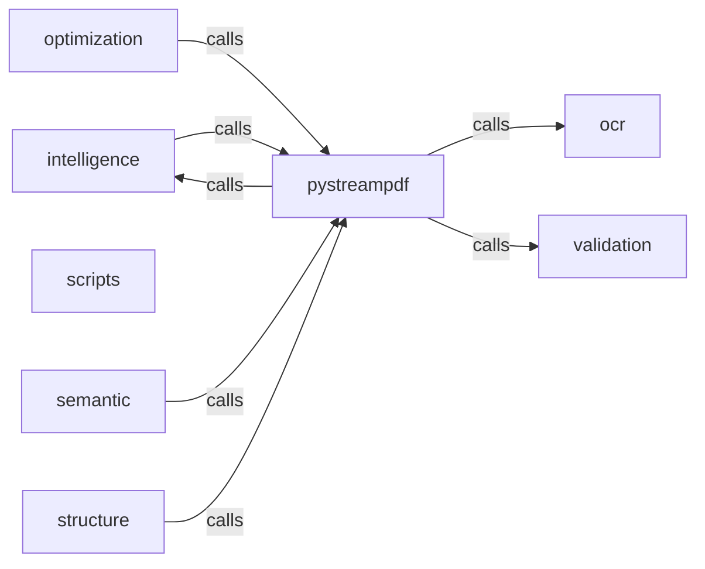

_Generated by CodeAtlas._

## Details

Owns 169 symbols across 13 file(s).

### intelligence

Owns 31 symbols across 7 file(s).

**Related Classes/Methods:** _None_

**Source Files:**

- `python/pystreampdf/intelligence/code_intelligence.py`
  - `python.pystreampdf.intelligence.code_intelligence.CodeAnalyzer`
  - `python.pystreampdf.intelligence.code_intelligence.CodeAnalyzer._check_brackets_balanced`
  - `python.pystreampdf.intelligence.code_intelligence.CodeAnalyzer._detect_language`
  - `python.pystreampdf.intelligence.code_intelligence.CodeAnalyzer._validate_python`
  - `python.pystreampdf.intelligence.code_intelligence.CodeAnalyzer.analyze`
- `python/pystreampdf/intelligence/json_intelligence.py`
  - `python.pystreampdf.intelligence.json_intelligence.JSONAnalyzer`
  - `python.pystreampdf.intelligence.json_intelligence.JSONAnalyzer._attempt_recovery`
  - `python.pystreampdf.intelligence.json_intelligence.JSONAnalyzer._calculate_depth`
  - `python.pystreampdf.intelligence.json_intelligence.JSONAnalyzer._extract_metadata`
  - `python.pystreampdf.intelligence.json_intelligence.JSONAnalyzer._infer_purpose`
  - `python.pystreampdf.intelligence.json_intelligence.JSONAnalyzer.analyze`
- `python/pystreampdf/intelligence/log_intelligence.py`
  - `python.pystreampdf.intelligence.log_intelligence.LogAnalyzer`
  - `python.pystreampdf.intelligence.log_intelligence.LogAnalyzer._detect_format`
  - `python.pystreampdf.intelligence.log_intelligence.LogAnalyzer._extract_level`
  - `python.pystreampdf.intelligence.log_intelligence.LogAnalyzer.analyze`
- `python/pystreampdf/intelligence/sql_intelligence.py`
  - `python.pystreampdf.intelligence.sql_intelligence.SQLAnalyzer`
  - `python.pystreampdf.intelligence.sql_intelligence.SQLAnalyzer._check_parentheses_balanced`
  - `python.pystreampdf.intelligence.sql_intelligence.SQLAnalyzer._check_strings_closed`
  - `python.pystreampdf.intelligence.sql_intelligence.SQLAnalyzer._detect_dialect`
  - `python.pystreampdf.intelligence.sql_intelligence.SQLAnalyzer._detect_query_type`
  - `python.pystreampdf.intelligence.sql_intelligence.SQLAnalyzer._extract_structure`
  - `python.pystreampdf.intelligence.sql_intelligence.SQLAnalyzer._parse_queries`
  - `python.pystreampdf.intelligence.sql_intelligence.SQLAnalyzer._validate_query`
  - `python.pystreampdf.intelligence.sql_intelligence.SQLAnalyzer.analyze`
- `python/pystreampdf/intelligence/types.py`
  - `python.pystreampdf.intelligence.types.CorrectionSuggestion`
  - `python.pystreampdf.intelligence.types.IntelligenceResult`
  - `python.pystreampdf.intelligence.types.IntelligenceResult.__post_init__`
- `python/pystreampdf/intelligence/yaml_intelligence.py`
  - `python.pystreampdf.intelligence.yaml_intelligence.YAMLAnalyzer`
  - `python.pystreampdf.intelligence.yaml_intelligence.YAMLAnalyzer.__init__`
  - `python.pystreampdf.intelligence.yaml_intelligence.YAMLAnalyzer._attempt_correction`
  - `python.pystreampdf.intelligence.yaml_intelligence.YAMLAnalyzer.analyze`

### ocr

Owns 26 symbols across 4 file(s).

**Related Classes/Methods:** _None_

**Source Files:**

- `python/pystreampdf/ocr/manager.py`
  - `python.pystreampdf.ocr.manager.OcrManager`
  - `python.pystreampdf.ocr.manager.OcrManager.__init__`
  - `python.pystreampdf.ocr.manager.OcrManager.auto`
  - `python.pystreampdf.ocr.manager.OcrManager.available_installed`
  - `python.pystreampdf.ocr.manager.OcrManager.available_providers`
  - `python.pystreampdf.ocr.manager.OcrManager.default`
  - `python.pystreampdf.ocr.manager.OcrManager.extract`
  - `python.pystreampdf.ocr.manager.OcrManager.register`
  - `python.pystreampdf.ocr.manager.OcrManager.select`
- `python/pystreampdf/ocr/pipeline.py`
  - `python.pystreampdf.ocr.pipeline.OcrPipeline`
  - `python.pystreampdf.ocr.pipeline.OcrPipeline.__init__`
  - `python.pystreampdf.ocr.pipeline.OcrPipeline._process_scanned_page`
  - `python.pystreampdf.ocr.pipeline.OcrPipeline.process_document`
  - `python.pystreampdf.ocr.pipeline.ProcessedPage`
- `python/pystreampdf/ocr/provider.py`
  - `python.pystreampdf.ocr.provider.OcrCapabilities`
  - `python.pystreampdf.ocr.provider.OcrProvider`
  - `python.pystreampdf.ocr.provider.OcrProvider.capabilities`
  - `python.pystreampdf.ocr.provider.OcrProvider.extract`
  - `python.pystreampdf.ocr.provider.OcrProvider.extract_batch`
  - `python.pystreampdf.ocr.provider.OcrProvider.is_available`
  - `python.pystreampdf.ocr.provider.OcrProvider.name`
  - `python.pystreampdf.ocr.provider.OcrProvider.version`
  - `python.pystreampdf.ocr.provider.OcrResult`
  - `python.pystreampdf.ocr.provider.OcrResult.__post_init__`
  - `python.pystreampdf.ocr.provider.TextRegion`
  - `python.pystreampdf.ocr.provider.TextRegion.__post_init__`

### optimization

Owns 35 symbols across 5 file(s).

**Related Classes/Methods:** _None_

**Source Files:**

- `python/pystreampdf/optimization/chunking.py`
  - `python.pystreampdf.optimization.chunking.ChunkingEngine`
  - `python.pystreampdf.optimization.chunking.ChunkingEngine.__init__`
  - `python.pystreampdf.optimization.chunking.ChunkingEngine._apply_token_budget`
  - `python.pystreampdf.optimization.chunking.ChunkingEngine._node_to_chunk`
  - `python.pystreampdf.optimization.chunking.ChunkingEngine.chunk_graph`
  - `python.pystreampdf.optimization.chunking.ChunkingEngine.explain_chunking`
  - `python.pystreampdf.optimization.chunking.ChunkingStrategy`
  - `python.pystreampdf.optimization.chunking.RAGChunk`
  - `python.pystreampdf.optimization.chunking.RAGChunk.to_retrieval_format`
  - `python.pystreampdf.optimization.chunking.RAGChunk.token_count`
- `python/pystreampdf/optimization/compressor.py`
  - `python.pystreampdf.optimization.compressor.AdaptiveCompressor`
  - `python.pystreampdf.optimization.compressor.AdaptiveCompressor._compress_lossless`
  - `python.pystreampdf.optimization.compressor.AdaptiveCompressor._compress_lossy`
  - `python.pystreampdf.optimization.compressor.AdaptiveCompressor.compress`
  - `python.pystreampdf.optimization.compressor.AdaptiveCompressor.suggest_ratio`
  - `python.pystreampdf.optimization.compressor.AdaptiveCompressor.suggest_strategy`
  - `python.pystreampdf.optimization.compressor.CompressionStrategy`
- `python/pystreampdf/optimization/metadata.py`
  - `python.pystreampdf.optimization.metadata.ChunkDensity`
  - `python.pystreampdf.optimization.metadata.MetadataInjector`
  - `python.pystreampdf.optimization.metadata.MetadataInjector.calculate_relevance`
  - `python.pystreampdf.optimization.metadata.MetadataInjector.estimate_density`
  - `python.pystreampdf.optimization.metadata.MetadataInjector.inject_metadata`
  - `python.pystreampdf.optimization.metadata.RetrievalMetadata`
  - `python.pystreampdf.optimization.metadata.RetrievalMetadata.to_dict`
- `python/pystreampdf/optimization/selector.py`
  - `python.pystreampdf.optimization.selector.ContentDetail`
  - `python.pystreampdf.optimization.selector.ContentSelector`
  - `python.pystreampdf.optimization.selector.ContentSelector.__init__`
  - `python.pystreampdf.optimization.selector.ContentSelector.select_batch`
  - `python.pystreampdf.optimization.selector.ContentSelector.select_for_rag`
  - `python.pystreampdf.optimization.selector.SelectionPolicy`
  - `python.pystreampdf.optimization.selector.SelectionPolicy.should_include`
  - `python.pystreampdf.optimization.selector.SelectiveIntelligence`
  - `python.pystreampdf.optimization.selector.SelectiveIntelligence.__init__`
  - `python.pystreampdf.optimization.selector.SelectiveIntelligence.customize_policy`
  - `python.pystreampdf.optimization.selector.SelectiveIntelligence.select_detail_level`

### scripts

Owns 1 symbols across 2 file(s).

**Related Classes/Methods:** _None_

**Source Files:**

- `python/pystreampdf/scripts/post_install.py`
  - `python.pystreampdf.scripts.post_install.post_install`

### semantic

Owns 77 symbols across 8 file(s).

**Related Classes/Methods:** _None_

**Source Files:**

- `python/pystreampdf/semantic/assembler.py`
  - `python.pystreampdf.semantic.assembler.AssembledContext`
  - `python.pystreampdf.semantic.assembler.AssemblyStrategy`
  - `python.pystreampdf.semantic.assembler.ContextAssembler`
  - `python.pystreampdf.semantic.assembler.ContextAssembler.__init__`
  - `python.pystreampdf.semantic.assembler.ContextAssembler._assemble_scholarly`
  - `python.pystreampdf.semantic.assembler.ContextAssembler._assemble_survey`
  - `python.pystreampdf.semantic.assembler.ContextAssembler._assemble_technical`
  - `python.pystreampdf.semantic.assembler.ContextAssembler._assemble_tutorial`
  - `python.pystreampdf.semantic.assembler.ContextAssembler._calculate_coherence`
  - `python.pystreampdf.semantic.assembler.ContextAssembler.assemble`
  - `python.pystreampdf.semantic.assembler.ContextAssembler.estimate_query_cost`
  - `python.pystreampdf.semantic.assembler.ContextAssembler.optimize_for_budget`
- `python/pystreampdf/semantic/citations.py`
  - `python.pystreampdf.semantic.citations.Citation`
  - `python.pystreampdf.semantic.citations.CitationNetwork`
  - `python.pystreampdf.semantic.citations.CitationNetwork.__init__`
  - `python.pystreampdf.semantic.citations.CitationNetwork.add_citation`
  - `python.pystreampdf.semantic.citations.CitationNetwork.add_paper`
  - `python.pystreampdf.semantic.citations.CitationNetwork.top_cited`
  - `python.pystreampdf.semantic.citations.CitationRelation`
- `python/pystreampdf/semantic/entities.py`
  - `python.pystreampdf.semantic.entities.ConceptExtractor`
  - `python.pystreampdf.semantic.entities.ConceptExtractor.__init__`
  - `python.pystreampdf.semantic.entities.ConceptExtractor._deduplicate`
  - `python.pystreampdf.semantic.entities.ConceptExtractor._extract_dates`
  - `python.pystreampdf.semantic.entities.ConceptExtractor._extract_metrics`
  - `python.pystreampdf.semantic.entities.ConceptExtractor._extract_organizations`
  - `python.pystreampdf.semantic.entities.ConceptExtractor._extract_people`
  - `python.pystreampdf.semantic.entities.ConceptExtractor._get_context`
  - `python.pystreampdf.semantic.entities.ConceptExtractor.batch_extract`
  - `python.pystreampdf.semantic.entities.ConceptExtractor.extract`
  - `python.pystreampdf.semantic.entities.ConceptExtractor.get_entities_by_type`
  - `python.pystreampdf.semantic.entities.ConceptExtractor.get_top_entities`
  - `python.pystreampdf.semantic.entities.Entity`
  - `python.pystreampdf.semantic.entities.EntityType`
- `python/pystreampdf/semantic/graph.py`
  - `python.pystreampdf.semantic.graph.GraphEdge`
  - `python.pystreampdf.semantic.graph.GraphNode`
  - `python.pystreampdf.semantic.graph.KnowledgeGraph`
  - `python.pystreampdf.semantic.graph.KnowledgeGraph.__init__`
  - `python.pystreampdf.semantic.graph.KnowledgeGraph.add_edge`
  - `python.pystreampdf.semantic.graph.KnowledgeGraph.add_node`
  - `python.pystreampdf.semantic.graph.KnowledgeGraph.calculate_influence`
  - `python.pystreampdf.semantic.graph.KnowledgeGraph.find_path`
  - `python.pystreampdf.semantic.graph.KnowledgeGraph.find_similar`
  - `python.pystreampdf.semantic.graph.KnowledgeGraph.get_node_stats`
  - `python.pystreampdf.semantic.graph.KnowledgeGraph.get_subgraph`
  - `python.pystreampdf.semantic.graph.KnowledgeGraph.merge`
  - `python.pystreampdf.semantic.graph.KnowledgeGraph.query`
  - `python.pystreampdf.semantic.graph.KnowledgeGraph.to_dict`
- `python/pystreampdf/semantic/relationships.py`
  - `python.pystreampdf.semantic.relationships.RelationType`
  - `python.pystreampdf.semantic.relationships.Relationship`
  - `python.pystreampdf.semantic.relationships.RelationshipExtractor`
  - `python.pystreampdf.semantic.relationships.RelationshipExtractor.__init__`
  - `python.pystreampdf.semantic.relationships.RelationshipExtractor._calculate_confidence`
  - `python.pystreampdf.semantic.relationships.RelationshipExtractor._deduplicate`
  - `python.pystreampdf.semantic.relationships.RelationshipExtractor._reverse_relation_type`
  - `python.pystreampdf.semantic.relationships.RelationshipExtractor.batch_extract`
  - `python.pystreampdf.semantic.relationships.RelationshipExtractor.extract`
  - `python.pystreampdf.semantic.relationships.RelationshipExtractor.find_relations`
  - `python.pystreampdf.semantic.relationships.RelationshipExtractor.get_related_entities`
- `python/pystreampdf/semantic/topics.py`
  - `python.pystreampdf.semantic.topics.Topic`
  - `python.pystreampdf.semantic.topics.TopicModel`
  - `python.pystreampdf.semantic.topics.TopicModel.__init__`
  - `python.pystreampdf.semantic.topics.TopicModel.train`
- `python/pystreampdf/semantic/verifier.py`
  - `python.pystreampdf.semantic.verifier.Evidence`
  - `python.pystreampdf.semantic.verifier.FactVerifier`
  - `python.pystreampdf.semantic.verifier.FactVerifier.__init__`
  - `python.pystreampdf.semantic.verifier.FactVerifier._analyze_evidence`
  - `python.pystreampdf.semantic.verifier.FactVerifier._calculate_relevance`
  - `python.pystreampdf.semantic.verifier.FactVerifier._calculate_support_level`
  - `python.pystreampdf.semantic.verifier.FactVerifier._extract_key_terms`
  - `python.pystreampdf.semantic.verifier.FactVerifier._find_evidence`
  - `python.pystreampdf.semantic.verifier.FactVerifier.generate_verification_report`
  - `python.pystreampdf.semantic.verifier.FactVerifier.get_evidence_for_term`
  - `python.pystreampdf.semantic.verifier.FactVerifier.is_hallucination`
  - `python.pystreampdf.semantic.verifier.FactVerifier.verify`
  - `python.pystreampdf.semantic.verifier.FactVerifier.verify_batch`
  - `python.pystreampdf.semantic.verifier.VerificationResult`
  - `python.pystreampdf.semantic.verifier.VerificationStatus`

### structure

Owns 55 symbols across 5 file(s).

**Related Classes/Methods:** _None_

**Source Files:**

- `python/pystreampdf/structure/builder.py`
  - `python.pystreampdf.structure.builder.DocumentGraph`
  - `python.pystreampdf.structure.builder.DocumentGraph.__init__`
  - `python.pystreampdf.structure.builder.DocumentGraph.add_edge`
  - `python.pystreampdf.structure.builder.DocumentGraph.add_node`
  - `python.pystreampdf.structure.builder.DocumentGraph.edge_count_by_type`
  - `python.pystreampdf.structure.builder.DocumentGraph.get_children`
  - `python.pystreampdf.structure.builder.DocumentGraph.get_parents`
  - `python.pystreampdf.structure.builder.DocumentGraph.get_related`
  - `python.pystreampdf.structure.builder.DocumentGraph.min_confidence`
  - `python.pystreampdf.structure.builder.DocumentGraph.node_count_by_type`
  - `python.pystreampdf.structure.builder.DocumentGraph.path_confidence`
  - `python.pystreampdf.structure.builder.DocumentGraph.set_root`
  - `python.pystreampdf.structure.builder.DocumentGraph.to_dict`
  - `python.pystreampdf.structure.builder.EdgeType`
  - `python.pystreampdf.structure.builder.GraphEdge`
  - `python.pystreampdf.structure.builder.GraphEdge.to_dict`
  - `python.pystreampdf.structure.builder.GraphNode`
  - `python.pystreampdf.structure.builder.GraphNode.to_dict`
  - `python.pystreampdf.structure.builder.NodeType`
- `python/pystreampdf/structure/exporters.py`
  - `python.pystreampdf.structure.exporters.GraphExporter`
  - `python.pystreampdf.structure.exporters.GraphExporter.export`
  - `python.pystreampdf.structure.exporters.JSONLDExporter`
  - `python.pystreampdf.structure.exporters.JSONLDExporter._map_node_type_to_schema`
  - `python.pystreampdf.structure.exporters.JSONLDExporter.export`
  - `python.pystreampdf.structure.exporters.MarkdownExporter`
  - `python.pystreampdf.structure.exporters.MarkdownExporter._export_subtree`
  - `python.pystreampdf.structure.exporters.MarkdownExporter.export`
  - `python.pystreampdf.structure.exporters.RAGOptimizedExporter`
  - `python.pystreampdf.structure.exporters.RAGOptimizedExporter._find_related`
  - `python.pystreampdf.structure.exporters.RAGOptimizedExporter.export`
  - `python.pystreampdf.structure.exporters.SimpleJSONExporter`
  - `python.pystreampdf.structure.exporters.SimpleJSONExporter.export`
- `python/pystreampdf/structure/recovery.py`
  - `python.pystreampdf.structure.recovery.DocumentMetadata`
  - `python.pystreampdf.structure.recovery.SectionHierarchy`
  - `python.pystreampdf.structure.recovery.StructureRecoveryEngine`
  - `python.pystreampdf.structure.recovery.StructureRecoveryEngine.__init__`
  - `python.pystreampdf.structure.recovery.StructureRecoveryEngine._build_section_hierarchy`
  - `python.pystreampdf.structure.recovery.StructureRecoveryEngine._detect_appendices`
  - `python.pystreampdf.structure.recovery.StructureRecoveryEngine._detect_figures`
  - `python.pystreampdf.structure.recovery.StructureRecoveryEngine._detect_tables`
  - `python.pystreampdf.structure.recovery.StructureRecoveryEngine._extract_cross_references`
  - `python.pystreampdf.structure.recovery.StructureRecoveryEngine._extract_sections`
  - `python.pystreampdf.structure.recovery.StructureRecoveryEngine._link_appendices`
  - `python.pystreampdf.structure.recovery.StructureRecoveryEngine._link_figures_to_sections`
  - `python.pystreampdf.structure.recovery.StructureRecoveryEngine._link_tables_to_sections`
  - `python.pystreampdf.structure.recovery.StructureRecoveryEngine.extract_metadata`
  - `python.pystreampdf.structure.recovery.StructureRecoveryEngine.recover_structure`
- `python/pystreampdf/structure/relationships.py`
  - `python.pystreampdf.structure.relationships.RelationType`
  - `python.pystreampdf.structure.relationships.RelationshipExtractor`
  - `python.pystreampdf.structure.relationships.RelationshipExtractor._extract_code_relationships`
  - `python.pystreampdf.structure.relationships.RelationshipExtractor._extract_json_relationships`
  - `python.pystreampdf.structure.relationships.RelationshipExtractor._extract_log_relationships`
  - `python.pystreampdf.structure.relationships.RelationshipExtractor._extract_sql_relationships`
  - `python.pystreampdf.structure.relationships.RelationshipExtractor._extract_yaml_relationships`
  - `python.pystreampdf.structure.relationships.RelationshipExtractor.extract_from_intelligence`

### validation

Owns 37 symbols across 6 file(s).

**Related Classes/Methods:** _None_

**Source Files:**

- `python/pystreampdf/validation/layout.py`
  - `python.pystreampdf.validation.layout.LayoutValidator`
  - `python.pystreampdf.validation.layout.LayoutValidator.__init__`
  - `python.pystreampdf.validation.layout.LayoutValidator._check_duplicate_h1s`
  - `python.pystreampdf.validation.layout.LayoutValidator._check_empty_headings`
  - `python.pystreampdf.validation.layout.LayoutValidator._check_hierarchy`
  - `python.pystreampdf.validation.layout.LayoutValidator.validate`
- `python/pystreampdf/validation/scorer.py`
  - `python.pystreampdf.validation.scorer.ConfidenceScorer`
  - `python.pystreampdf.validation.scorer.ConfidenceScorer.__init__`
  - `python.pystreampdf.validation.scorer.ConfidenceScorer._grade`
  - `python.pystreampdf.validation.scorer.ConfidenceScorer._suggest_provider`
  - `python.pystreampdf.validation.scorer.ConfidenceScorer.recommend`
  - `python.pystreampdf.validation.scorer.ConfidenceScorer.score`
- `python/pystreampdf/validation/table.py`
  - `python.pystreampdf.validation.table.TableValidator`
  - `python.pystreampdf.validation.table.TableValidator.__init__`
  - `python.pystreampdf.validation.table.TableValidator._check_column_consistency`
  - `python.pystreampdf.validation.table.TableValidator._check_corrupted_cells`
  - `python.pystreampdf.validation.table.TableValidator._check_empty_cells`
  - `python.pystreampdf.validation.table.TableValidator._estimate_accuracy`
  - `python.pystreampdf.validation.table.TableValidator.validate`
- `python/pystreampdf/validation/text.py`
  - `python.pystreampdf.validation.text.TextValidator`
  - `python.pystreampdf.validation.text.TextValidator.__init__`
  - `python.pystreampdf.validation.text.TextValidator._find_corrupted_chars`
  - `python.pystreampdf.validation.text.TextValidator._has_broken_sequence`
  - `python.pystreampdf.validation.text.TextValidator._has_repetition`
  - `python.pystreampdf.validation.text.TextValidator._has_truncation`
  - `python.pystreampdf.validation.text.TextValidator.validate`
- `python/pystreampdf/validation/types.py`
  - `python.pystreampdf.validation.types.OcrTable`
  - `python.pystreampdf.validation.types.PageConfidenceScore`
  - `python.pystreampdf.validation.types.PageConfidenceScore.__post_init__`
  - `python.pystreampdf.validation.types.Recommendation`
  - `python.pystreampdf.validation.types.Recommendation.__post_init__`
  - `python.pystreampdf.validation.types.TableValidationResult`
  - `python.pystreampdf.validation.types.TableValidationResult.__post_init__`
  - `python.pystreampdf.validation.types.ValidationIssue`
  - `python.pystreampdf.validation.types.ValidationIssue.__post_init__`
  - `python.pystreampdf.validation.types.ValidationResult`
  - `python.pystreampdf.validation.types.ValidationResult.__post_init__`
