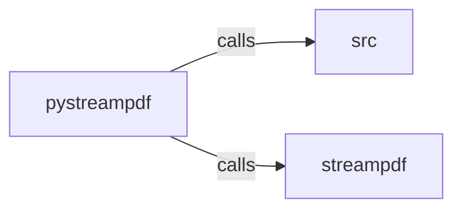

_Generated by CodeAtlas._

## Details

Owns 0 symbols across 1 file(s).

### pystreampdf

Owns 169 symbols across 13 file(s).

**Related Classes/Methods:** _None_

**Source Files:**

- `python/pystreampdf/_mcp_connector.py`
  - `python.pystreampdf._mcp_connector.BaseMCPConnector`
  - `python.pystreampdf._mcp_connector.BaseMCPConnector.__init__`
  - `python.pystreampdf._mcp_connector.BaseMCPConnector._generate_dab_config`
  - `python.pystreampdf._mcp_connector.BaseMCPConnector._start_dab_subprocess`
  - `python.pystreampdf._mcp_connector.BaseMCPConnector._write_temp_config`
  - `python.pystreampdf._mcp_connector.BaseMCPConnector.get_mcp_tools`
  - `python.pystreampdf._mcp_connector.BaseMCPConnector.get_tool_handlers`
  - `python.pystreampdf._mcp_connector.BaseMCPConnector.is_ready`
  - `python.pystreampdf._mcp_connector.BaseMCPConnector.start_mcp_connector`
  - `python.pystreampdf._mcp_connector.BaseMCPConnector.stop_mcp_connector`
  - `python.pystreampdf._mcp_connector.PDFProcessor`
  - `python.pystreampdf._mcp_connector.PDFProcessor.__init__`
  - `python.pystreampdf._mcp_connector.PDFProcessor.start_mcp_connector`
  - `python.pystreampdf._mcp_connector.PDFProcessor.stop_mcp_connector`
  - `python.pystreampdf._mcp_connector._MCPPDFConnector`
  - `python.pystreampdf._mcp_connector._MCPPDFConnector.__init__`
  - `python.pystreampdf._mcp_connector._MCPPDFConnector.get_mcp_tools`
  - `python.pystreampdf._mcp_connector._MCPPDFConnector.get_tool_handlers`
- `python/pystreampdf/_mcp_tools.py`
  - `python.pystreampdf._mcp_tools.PyStreamPDFMCPHandler`
  - `python.pystreampdf._mcp_tools.PyStreamPDFMCPHandler.__init__`
  - `python.pystreampdf._mcp_tools.PyStreamPDFMCPHandler._open`
  - `python.pystreampdf._mcp_tools.PyStreamPDFMCPHandler.apply_ocr`
  - `python.pystreampdf._mcp_tools.PyStreamPDFMCPHandler.chunk_document`
  - `python.pystreampdf._mcp_tools.PyStreamPDFMCPHandler.detect_document_structure`
  - `python.pystreampdf._mcp_tools.PyStreamPDFMCPHandler.detect_document_structure.count_headings`
  - `python.pystreampdf._mcp_tools.PyStreamPDFMCPHandler.detect_document_structure.heading_to_dict`
  - `python.pystreampdf._mcp_tools.PyStreamPDFMCPHandler.detect_forms`
  - `python.pystreampdf._mcp_tools.PyStreamPDFMCPHandler.detect_language`
  - `python.pystreampdf._mcp_tools.PyStreamPDFMCPHandler.export_processed_document`
  - `python.pystreampdf._mcp_tools.PyStreamPDFMCPHandler.extract_citations`
  - `python.pystreampdf._mcp_tools.PyStreamPDFMCPHandler.extract_images`
  - `python.pystreampdf._mcp_tools.PyStreamPDFMCPHandler.extract_metadata`
  - `python.pystreampdf._mcp_tools.PyStreamPDFMCPHandler.extract_tables`
  - `python.pystreampdf._mcp_tools.PyStreamPDFMCPHandler.extract_text`
  - `python.pystreampdf._mcp_tools.PyStreamPDFMCPHandler.validate_pdf`
  - `python.pystreampdf._mcp_tools.PyStreamPDFMCPTools`
  - `python.pystreampdf._mcp_tools.PyStreamPDFMCPTools.get_tools`
  - `python.pystreampdf._mcp_tools._parse_page_range`
- `python/pystreampdf/cache.py`
  - `python.pystreampdf.cache.CachedDocument`
  - `python.pystreampdf.cache.CachedDocument.memory_size_bytes`
  - `python.pystreampdf.cache.PDFCache`
  - `python.pystreampdf.cache.PDFCache.__init__`
  - `python.pystreampdf.cache.PDFCache._add_to_l1`
  - `python.pystreampdf.cache.PDFCache._add_to_l2`
  - `python.pystreampdf.cache.PDFCache._compute_hash`
  - `python.pystreampdf.cache.PDFCache._get_from_l1`
  - `python.pystreampdf.cache.PDFCache._get_from_l2`
  - `python.pystreampdf.cache.PDFCache._is_expired`
  - `python.pystreampdf.cache.PDFCache._load_or_create_hmac_key`
  - `python.pystreampdf.cache.PDFCache._re_evaluate_budget`
  - `python.pystreampdf.cache.PDFCache.clear`
  - `python.pystreampdf.cache.PDFCache.get_or_process`
  - `python.pystreampdf.cache.PDFCache.invalidate`
  - `python.pystreampdf.cache.PDFCache.stats`
- `python/pystreampdf/cli.py`
  - `python.pystreampdf.cli.dashboard_command`
  - `python.pystreampdf.cli.main`
- `python/pystreampdf/cli_daemon.py`
  - `python.pystreampdf.cli_daemon.DashboardDaemon`
  - `python.pystreampdf.cli_daemon.DashboardDaemon.__init__`
  - `python.pystreampdf.cli_daemon.DashboardDaemon._handle_interrupt`
  - `python.pystreampdf.cli_daemon.DashboardDaemon.start`
  - `python.pystreampdf.cli_daemon.start_persistent_dashboard`
- `python/pystreampdf/cli_dashboard.py`
  - `python.pystreampdf.cli_dashboard.DashboardMetrics`
  - `python.pystreampdf.cli_dashboard.PyStreamPDFDashboard`
  - `python.pystreampdf.cli_dashboard.PyStreamPDFDashboard.__init__`
  - `python.pystreampdf.cli_dashboard.PyStreamPDFDashboard.export_json`
  - `python.pystreampdf.cli_dashboard.PyStreamPDFDashboard.get_mock_metrics`
  - `python.pystreampdf.cli_dashboard.PyStreamPDFDashboard.run_dashboard`
  - `python.pystreampdf.cli_dashboard.PyStreamPDFDashboard.show_alerts`
  - `python.pystreampdf.cli_dashboard.PyStreamPDFDashboard.show_recommendations`
  - `python.pystreampdf.cli_dashboard.RichDashboard`
  - `python.pystreampdf.cli_dashboard.RichDashboard.__init__`
  - `python.pystreampdf.cli_dashboard.RichDashboard.render`
  - `python.pystreampdf.cli_dashboard.RichDashboard.run`
  - `python.pystreampdf.cli_dashboard.SimpleDashboard`
  - `python.pystreampdf.cli_dashboard.SimpleDashboard.__init__`
  - `python.pystreampdf.cli_dashboard.SimpleDashboard.render`
  - `python.pystreampdf.cli_dashboard.SimpleDashboard.run`
  - `python.pystreampdf.cli_dashboard.TextualDashboard`
  - `python.pystreampdf.cli_dashboard.TextualDashboard.__init__`
  - `python.pystreampdf.cli_dashboard.TextualDashboard.render`
  - `python.pystreampdf.cli_dashboard.TextualDashboard.run`
  - `python.pystreampdf.cli_dashboard._module_available`
  - `python.pystreampdf.cli_dashboard.get_dashboard_impl`
- `python/pystreampdf/excel_export.py`
  - `python.pystreampdf.excel_export.ExcelExporter`
  - `python.pystreampdf.excel_export.ExcelExporter.__init__`
  - `python.pystreampdf.excel_export.ExcelExporter._export_table_to_sheet`
  - `python.pystreampdf.excel_export.ExcelExporter.export_tables_to_excel`
  - `python.pystreampdf.excel_export.ExtractedTable`
  - `python.pystreampdf.excel_export.ExtractedTable.normalize_for_excel`
  - `python.pystreampdf.excel_export.ExtractedTable.to_dict_rows`
  - `python.pystreampdf.excel_export.PDFToExcelPipeline`
  - `python.pystreampdf.excel_export.PDFToExcelPipeline.__init__`
  - `python.pystreampdf.excel_export.PDFToExcelPipeline._validate_tables_quality`
  - `python.pystreampdf.excel_export.PDFToExcelPipeline.convert_pdf_to_excel`
  - `python.pystreampdf.excel_export.PDFToExcelPipeline.set_quality_validator`
  - `python.pystreampdf.excel_export.TableCell`
  - `python.pystreampdf.excel_export.TableCell.__post_init__`
  - `python.pystreampdf.excel_export.TableExtractor`
  - `python.pystreampdf.excel_export.TableExtractor.__init__`
  - `python.pystreampdf.excel_export.TableExtractor._detect_table_in_text`
  - `python.pystreampdf.excel_export.TableExtractor._extract_tables_from_page`
  - `python.pystreampdf.excel_export.TableExtractor.extract_tables_from_pdf`
  - `python.pystreampdf.excel_export.convert_pdf_to_excel`
  - `python.pystreampdf.excel_export.export_tables_to_excel`
  - `python.pystreampdf.excel_export.extract_tables_from_pdf`
- `python/pystreampdf/extraction.py`
  - `python.pystreampdf.extraction.CitationTracker`
  - `python.pystreampdf.extraction.CitationTracker.__init__`
  - `python.pystreampdf.extraction.CitationTracker.add_citation`
  - `python.pystreampdf.extraction.CitationTracker.get_source`
  - `python.pystreampdf.extraction.CitationTracker.verify_hallucination`
  - `python.pystreampdf.extraction.ContentChunk`
  - `python.pystreampdf.extraction.ElementType`
  - `python.pystreampdf.extraction.MultimediaAnalyzer`
  - `python.pystreampdf.extraction.MultimediaAnalyzer.__init__`
  - `python.pystreampdf.extraction.MultimediaAnalyzer.detect_images`
  - `python.pystreampdf.extraction.MultimediaAnalyzer.generate_alt_text`
  - `python.pystreampdf.extraction.MultimediaElement`
  - `python.pystreampdf.extraction.ReadingOrder`
  - `python.pystreampdf.extraction.ReadingOrderCorrector`
  - `python.pystreampdf.extraction.ReadingOrderCorrector.__init__`
  - `python.pystreampdf.extraction.ReadingOrderCorrector.analyze_fragments`
  - `python.pystreampdf.extraction.ReadingOrderCorrector.correct_order`
  - `python.pystreampdf.extraction.ReadingOrderCorrector.merge_fragments`
  - `python.pystreampdf.extraction.SemanticChunker`
  - `python.pystreampdf.extraction.SemanticChunker.__init__`
  - `python.pystreampdf.extraction.SemanticChunker.chunk_content`
  - `python.pystreampdf.extraction.SourceLocation`
  - `python.pystreampdf.extraction.TableCell`
  - `python.pystreampdf.extraction.TableExtractor`
  - `python.pystreampdf.extraction.TableExtractor.__init__`
  - `python.pystreampdf.extraction.TableExtractor._cluster_coordinates`
  - `python.pystreampdf.extraction.TableExtractor.detect_table_grid`
  - `python.pystreampdf.extraction.TableExtractor.extract_table`
  - `python.pystreampdf.extraction.TableStructure`
  - `python.pystreampdf.extraction.TextFragment`
- `python/pystreampdf/okf_entity_profiles.py`
  - `python.pystreampdf.okf_entity_profiles.EntityProfile`
  - `python.pystreampdf.okf_entity_profiles.OKFEntityProfiles`
  - `python.pystreampdf.okf_entity_profiles.OKFEntityProfiles.__init__`
  - `python.pystreampdf.okf_entity_profiles.OKFEntityProfiles.get_profile`
  - `python.pystreampdf.okf_entity_profiles.OKFEntityProfiles.is_safe_to_extract`
  - `python.pystreampdf.okf_entity_profiles.OKFEntityProfiles.rank_entities_by_confidence`
  - `python.pystreampdf.okf_entity_profiles.OKFEntityProfiles.save_profile`
- `python/pystreampdf/pipeline.py`
  - `python.pystreampdf.pipeline.AnalysisMetrics`
  - `python.pystreampdf.pipeline.AnalysisMetrics.cost_ratio`
  - `python.pystreampdf.pipeline.AnalysisPipeline`
  - `python.pystreampdf.pipeline.AnalysisPipeline.__init__`
  - `python.pystreampdf.pipeline.AnalysisPipeline._run_intelligence_stage`
  - `python.pystreampdf.pipeline.AnalysisPipeline.analyze`
  - `python.pystreampdf.pipeline.AnalysisPipeline.get_confidence_report`
  - `python.pystreampdf.pipeline.AnalysisStage`
  - `python.pystreampdf.pipeline.UnifiedAnalysisResult`
  - `python.pystreampdf.pipeline.UnifiedAnalysisResult.add_error`
  - `python.pystreampdf.pipeline.UnifiedAnalysisResult.add_metric`
  - `python.pystreampdf.pipeline.UnifiedAnalysisResult.compute_confidence`
  - `python.pystreampdf.pipeline.UnifiedAnalysisResult.get_recommendation`
  - `python.pystreampdf.pipeline.UnifiedAnalysisResult.most_expensive_stage`
  - `python.pystreampdf.pipeline.UnifiedAnalysisResult.to_dict`
  - `python.pystreampdf.pipeline.UnifiedAnalysisResult.total_duration_ms`
- `python/pystreampdf/token_budget.py`
  - `python.pystreampdf.token_budget.BudgetRule`
  - `python.pystreampdf.token_budget.BudgetRule.matches`
  - `python.pystreampdf.token_budget.TokenBudgetConfig`
  - `python.pystreampdf.token_budget.TokenBudgetConfig.__init__`
  - `python.pystreampdf.token_budget.TokenBudgetConfig.evaluate`
  - `python.pystreampdf.token_budget.TokenBudgetConfig.from_dict`
  - `python.pystreampdf.token_budget.TokenBudgetConfig.from_yaml`
  - `python.pystreampdf.token_budget.TokenBudgetConfig.to_dict`
  - `python.pystreampdf.token_budget.TokenBudgetConfig.to_yaml`
- `python/pystreampdf/tokenizer.py`
  - `python.pystreampdf.tokenizer.count_tokens`
  - `python.pystreampdf.tokenizer.is_exact`

### src

Owns 101 symbols across 1 file(s).

**Related Classes/Methods:** _None_

**Source Files:**

- `python/src/lib.rs`
  - `python.src.lib.PyAgentContext`
  - `python.src.lib.PyAgentContext.query`
  - `python.src.lib.PyAgentContext.sections`
  - `python.src.lib.PyAgentContext.total_tokens`
  - `python.src.lib.PyAuditLog`
  - `python.src.lib.PyAuditLog.events`
  - `python.src.lib.PyAuditLog.new`
  - `python.src.lib.PyAuditLog.record_open`
  - `python.src.lib.PyAuditLog.record_search`
  - `python.src.lib.PyBoundingBox`
  - `python.src.lib.PyBoundingBox.height`
  - `python.src.lib.PyBoundingBox.width`
  - `python.src.lib.PyBoundingBox.x`
  - `python.src.lib.PyBoundingBox.y`
  - `python.src.lib.PyContentRegion`
  - `python.src.lib.PyContentRegion.bounds`
  - `python.src.lib.PyContentRegion.font_size`
  - `python.src.lib.PyContentRegion.region_type`
  - `python.src.lib.PyContentRegion.text`
  - `python.src.lib.PyContextSection`
  - `python.src.lib.PyContextSection.content`
  - `python.src.lib.PyContextSection.heading_path`
  - `python.src.lib.PyContextSection.page_numbers`
  - `python.src.lib.PyContextSection.relevance_score`
  - `python.src.lib.PyDocumentStructure`
  - `python.src.lib.PyDocumentStructure.headings`
  - `python.src.lib.PyDocumentStructure.toc`
  - `python.src.lib.PyHeadingNode`
  - `python.src.lib.PyHeadingNode.children`
  - `python.src.lib.PyHeadingNode.level`
  - `python.src.lib.PyHeadingNode.page_number`
  - `python.src.lib.PyHeadingNode.text`
  - `python.src.lib.PyHeadingSection`
  - `python.src.lib.PyHeadingSection.end_page`
  - `python.src.lib.PyHeadingSection.heading`
  - `python.src.lib.PyHeadingSection.start_page`
  - `python.src.lib.PyHeadingSection.total_words`
  - `python.src.lib.PyMarkdownOutput`
  - `python.src.lib.PyMarkdownOutput.estimated_tokens`
  - `python.src.lib.PyMarkdownOutput.markdown`
  - `python.src.lib.PyMarkdownOutput.pages_included`
  - `python.src.lib.PyPageMetadata`
  - `python.src.lib.PyPageMetadata.__repr__`
  - `python.src.lib.PyPageMetadata.height`
  - `python.src.lib.PyPageMetadata.is_likely_scanned`
  - `python.src.lib.PyPageMetadata.label`
  - `python.src.lib.PyPageMetadata.page_number`
  - `python.src.lib.PyPageMetadata.regions`
  - `python.src.lib.PyPageMetadata.rotation`
  - `python.src.lib.PyPageMetadata.text`
  - `python.src.lib.PyPageMetadata.text_preview`
  - `python.src.lib.PyPageMetadata.width`
  - `python.src.lib.PyPageMetadata.word_count`
  - `python.src.lib.PyPageResult`
  - `python.src.lib.PyPageResult.page_number`
  - `python.src.lib.PyPageResult.score`
  - `python.src.lib.PyPageResult.snippet`
  - `python.src.lib.PyPdfDocument`
  - `python.src.lib.PyPdfDocument.all_pages`
  - `python.src.lib.PyPdfDocument.build_index`
  - `python.src.lib.PyPdfDocument.fingerprint`
  - `python.src.lib.PyPdfDocument.form_fields`
  - `python.src.lib.PyPdfDocument.has_forms`
  - `python.src.lib.PyPdfDocument.is_encrypted`
  - `python.src.lib.PyPdfDocument.metadata`
  - `python.src.lib.PyPdfDocument.navigator`
  - `python.src.lib.PyPdfDocument.navigator_with_index`
  - `python.src.lib.PyPdfDocument.open`
  - `python.src.lib.PyPdfDocument.open_with_password`
  - `python.src.lib.PyPdfDocument.page`
  - `python.src.lib.PyPdfDocument.page_count`
  - `python.src.lib.PyPdfDocument.path`
  - `python.src.lib.PyPdfDocument.permissions`
  - `python.src.lib.PyPdfDocument.structure`
  - `python.src.lib.PyPdfFormField`
  - `python.src.lib.PyPdfFormField.field_type`
  - `python.src.lib.PyPdfFormField.name`
  - `python.src.lib.PyPdfFormField.page_number`
  - `python.src.lib.PyPdfFormField.value`
  - `python.src.lib.PyPdfIndex`
  - `python.src.lib.PyPdfIndex.load`
  - `python.src.lib.PyPdfIndex.page_range`
  - `python.src.lib.PyPdfIndex.pages_with_heading`
  - `python.src.lib.PyPdfIndex.search`
  - `python.src.lib.PyPdfNavigator`
  - `python.src.lib.PyPdfNavigator.chapters`
  - `python.src.lib.PyPdfNavigator.page_to_markdown`
  - `python.src.lib.PyPdfNavigator.retrieve`
  - `python.src.lib.PyPdfNavigator.section_to_markdown`
  - `python.src.lib.PyPdfPermissions`
  - `python.src.lib.PyPdfPermissions.can_annotate`
  - `python.src.lib.PyPdfPermissions.can_copy`
  - `python.src.lib.PyPdfPermissions.can_modify`
  - `python.src.lib.PyPdfPermissions.can_print`
  - `python.src.lib.PyTocEntry`
  - `python.src.lib.PyTocEntry.level`
  - `python.src.lib.PyTocEntry.page_number`
  - `python.src.lib.PyTocEntry.title`
  - `python.src.lib._core`
  - `python.src.lib.load_index`
  - `python.src.lib.open`

### streampdf

Owns 28 symbols across 2 file(s).

**Related Classes/Methods:** _None_

**Source Files:**

- `python/streampdf/cli.py`
  - `python.streampdf.cli.CLIInterface`
  - `python.streampdf.cli.CLIInterface.__init__`
  - `python.streampdf.cli.CLIInterface.build_index`
  - `python.streampdf.cli.CLIInterface.extract_text`
  - `python.streampdf.cli.CLIInterface.get_document_info`
  - `python.streampdf.cli.CLIInterface.list_documents`
  - `python.streampdf.cli.CLIInterface.open_document`
  - `python.streampdf.cli.CLIInterface.search_document`
  - `python.streampdf.cli.main`
  - `python.streampdf.cli.print_help`
- `python/streampdf/server.py`
  - `python.streampdf.server.StreamPDFServer`
  - `python.streampdf.server.StreamPDFServer.__init__`
  - `python.streampdf.server.StreamPDFServer.build_index`
  - `python.streampdf.server.StreamPDFServer.extract_text`
  - `python.streampdf.server.StreamPDFServer.get_document_info`
  - `python.streampdf.server.StreamPDFServer.health_check`
  - `python.streampdf.server.StreamPDFServer.list_documents`
  - `python.streampdf.server.StreamPDFServer.open_document`
  - `python.streampdf.server.StreamPDFServer.search_document`
  - `python.streampdf.server.create_flask_app`
  - `python.streampdf.server.create_flask_app.build_index`
  - `python.streampdf.server.create_flask_app.extract_text`
  - `python.streampdf.server.create_flask_app.get_document`
  - `python.streampdf.server.create_flask_app.health`
  - `python.streampdf.server.create_flask_app.list_documents`
  - `python.streampdf.server.create_flask_app.open_document`
  - `python.streampdf.server.create_flask_app.search`
  - `python.streampdf.server.run_server`
